# Laporan Praktikum 2

## Komunikasi Antarproses pada Sistem Terdistribusi

**Mata kuliah:** Praktikum Sistem Terdistribusi dan Terdesentralisasi

**Program studi:** Informatika, Universitas Teknologi Digital Indonesia

**Nama:** Apriliva Putri P

**NIM:** 255410035

## Tujuan Praktikum

1. Mengamati proses yang sedang berjalan pada komputer Windows.
2. Menjalankan aplikasi, menemukan proses dan PID-nya, kemudian menghentikan proses tersebut tanpa menutup aplikasi melalui perintah keluar di dalam aplikasi.
3. Membuat server GraphQL menggunakan Strawberry dan mengaksesnya melalui antarmuka GraphiQL.
4. Membuat client Python yang mengirim query ke server dan mengamati hubungan komunikasi client-server, termasuk keadaan ketika server tidak aktif.

## Dasar Teori

### Proses pada satu node

Proses adalah program yang sedang dieksekusi. Sistem operasi mengelola proses, termasuk state, alokasi sumber daya, penjadwalan CPU, dan penghentian proses. Setiap proses memiliki **process identifier (PID)** sebagai identitas selama proses tersebut berjalan. PID dapat berubah ketika aplikasi dijalankan kembali.

Pada Windows, proses dapat diamati melalui **Task Manager** atau melalui PowerShell. Perintah `Get-Process` menampilkan proses; `Start-Process` menjalankan aplikasi; `Stop-Process` menghentikan proses berdasarkan nama atau PID. Opsi `-Force` meminta penghentian paksa. Menghentikan proses dengan cara ini berbeda dari memilih **Exit** di dalam aplikasi: sistem operasi yang menghentikan prosesnya.

### Komunikasi antarproses terdistribusi

Proses pada komputer berbeda tidak dapat mengandalkan shared memory dan tidak selalu memiliki clock yang sama. Karena itu, proses perlu bertukar pesan melalui mekanisme komunikasi jaringan, misalnya HTTP. Pada pola client-server, client mengirim permintaan ke alamat server, server memproses permintaan, lalu mengirimkan respons.

GraphQL adalah bahasa query dan spesifikasi untuk meminta data dari server. Server mendefinisikan schema beserta field yang tersedia; client mengirim query untuk memilih data yang dibutuhkan. **Strawberry** menyediakan implementasi GraphQL untuk Python. Dalam praktikum ini, server Strawberry menyediakan field `books`, sedangkan client mengirim query melalui HTTP POST dengan payload JSON. GraphiQL digunakan sebagai antarmuka browser untuk mencoba query secara interaktif.

## Alat dan Bahan

- Komputer dengan sistem operasi Windows dan PowerShell.
- Python dan `uv` untuk mengelola versi/interpreter serta lingkungan virtual Python.
- Paket `strawberry-graphql[cli]` dan Uvicorn untuk menjalankan aplikasi ASGI.
- Browser untuk membuka antarmuka GraphiQL.
- Source code server `schema.py` dan client `client.py` di folder [`workspace-01`](workspace-01/).

## Langkah Praktikum dan Hasil

### I. Mengamati dan mengelola proses pada satu node

#### 1. Mengamati proses yang berjalan

Task Manager menunjukkan aplikasi yang sedang aktif, seperti Command Prompt, Google Chrome, Task Manager, WhatsApp, Windows Explorer, dan WPS Office. Pada saat tangkapan layar dibuat, Task Manager juga menampilkan 138 background processes. Jumlah serta daftar proses dapat berbeda bergantung pada aplikasi yang sedang dibuka dan kondisi komputer.

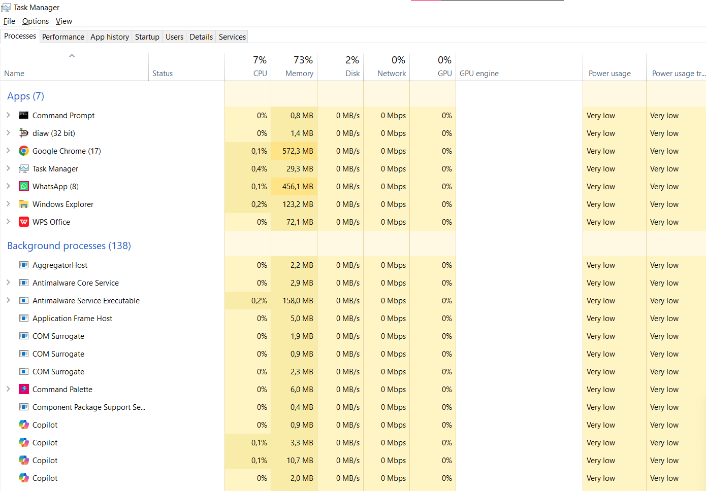

#### 2. Menjalankan aplikasi dan mencari PID

Notepad dijalankan sebagai aplikasi uji. Keberadaannya terlihat pada daftar aplikasi di Task Manager dan dapat diperiksa dari PowerShell menggunakan:

```powershell
Start-Process notepad.exe
Get-Process notepad
```

`Get-Process` menampilkan nama proses `notepad` dan PID. Pada tangkapan layar pertama, PID yang diperoleh adalah **19212**.

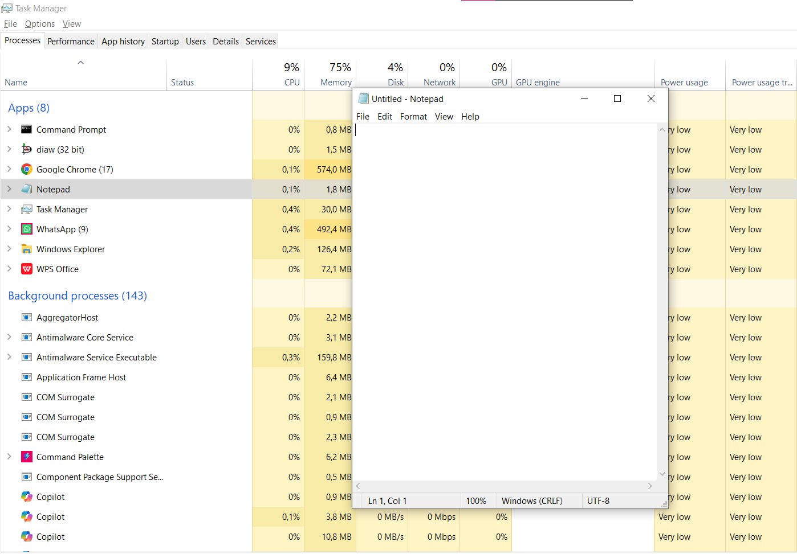

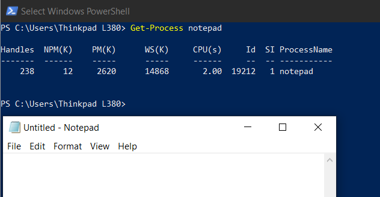

#### 3. Menghentikan proses tanpa perintah keluar aplikasi

Proses Notepad dihentikan dari PowerShell, bukan dengan memilih menu keluar di Notepad:

```powershell
Stop-Process -Id 19212
Get-Process notepad
```

Perintah kedua menghasilkan pesan bahwa proses `notepad` tidak ditemukan. Ini menandakan proses dengan PID tersebut sudah tidak berjalan.

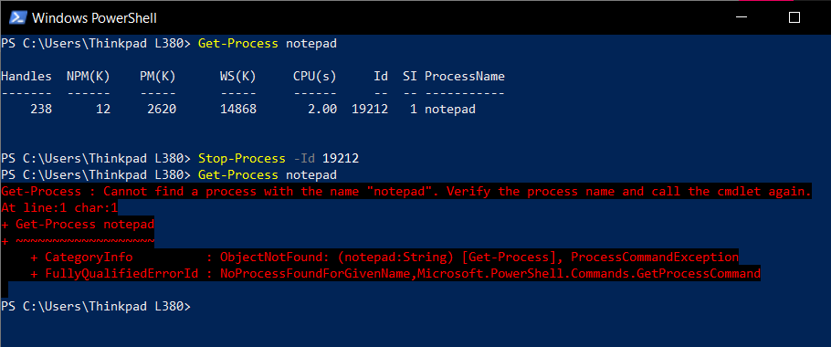

Untuk mengulangi percobaan, Notepad dijalankan kembali. PID baru yang terlihat adalah **23396**, berbeda dari PID sebelumnya. Proses baru mendapatkan identitas proses baru dari sistem operasi.

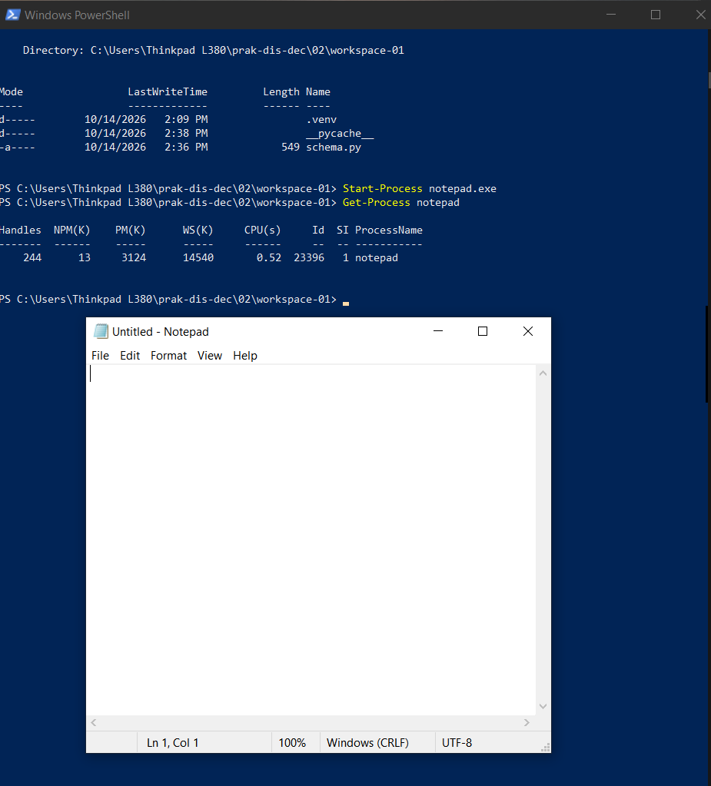

Proses kedua dihentikan menggunakan `-Force`, kemudian diperiksa kembali:

```powershell
Stop-Process -Id 23396 -Force
Get-Process notepad
```

Hasil pemeriksaan kembali menunjukkan bahwa proses Notepad tidak ditemukan.

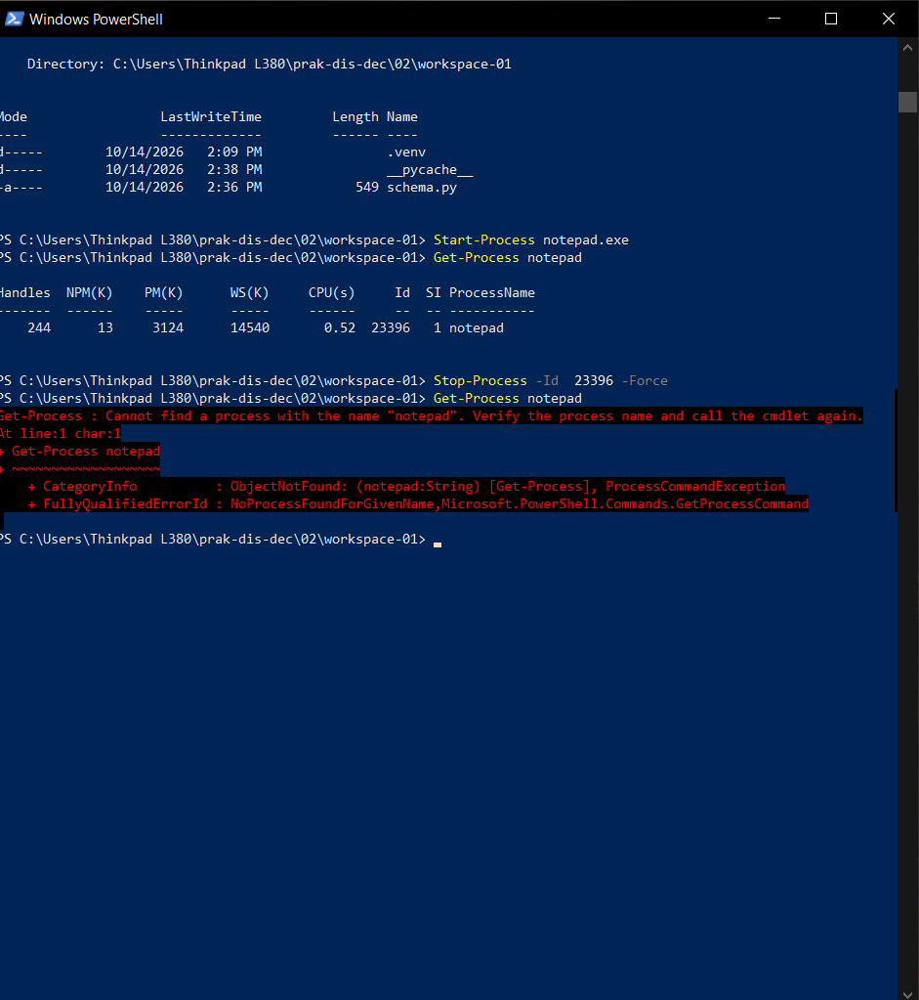

**Cara me-restart proses:** proses aplikasi dapat dihentikan lalu dijalankan kembali, misalnya dengan `Stop-Process -Id <PID>` diikuti `Start-Process notepad.exe`. Proses yang dijalankan ulang merupakan proses baru, sehingga PID-nya dapat berbeda. Untuk aplikasi yang menyediakan layanan restart khusus, prosedurnya dapat berbeda; praktikum ini menunjukkan pola berhenti lalu mulai kembali.

### II. Komunikasi client-server GraphQL

#### 1. Menyiapkan workspace dan lingkungan Python

Workspace praktikum bernama `workspace-01`. Versi `uv` yang terlihat pada terminal adalah **0.12.23**.

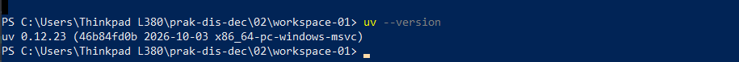

Python **3.14.8** tersedia melalui `uv`. Tangkapan layar daftar interpreter juga menunjukkan beberapa versi Python lain yang ada pada komputer.

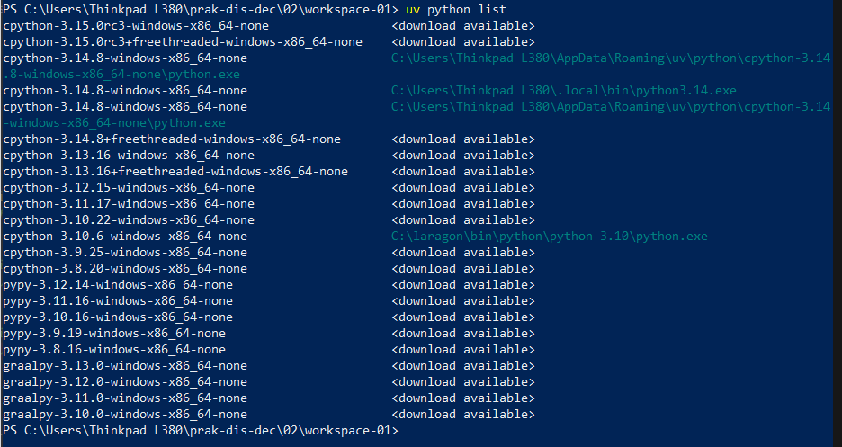

Lingkungan virtual dibuat dan diaktifkan dari folder workspace. Perintah dasarnya:

```powershell
uv venv --python 3.14
.\.venv\Scripts\Activate.ps1
```

Pada salah satu pemeriksaan awal setelah aktivasi, `python --version` menunjukkan **3.10.6**. Karena praktikum mensyaratkan Python 3.14, versi ini perlu diverifikasi ketika environment dibuat. Tangkapan layar berikutnya menunjukkan `python --version` **3.14.8**; server juga dijalankan menggunakan interpreter di `.venv`. Dengan demikian, hasil akhir menggunakan interpreter 3.14.8, tetapi pemeriksaan awal tersebut memperlihatkan pentingnya memastikan interpreter yang aktif, bukan hanya versi yang tersedia di komputer.

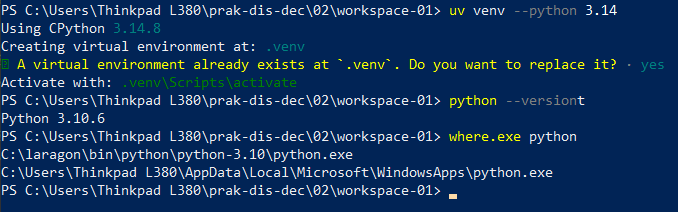

#### 2. Menginstal paket yang dibutuhkan

Paket GraphQL diinstal dengan perintah berikut:

```powershell
uv pip install "strawberry-graphql[cli]"
```

Tangkapan layar menunjukkan instalasi paket Strawberry dan dependensinya berhasil. Uvicorn juga dipastikan terpasang untuk menjalankan aplikasi ASGI.

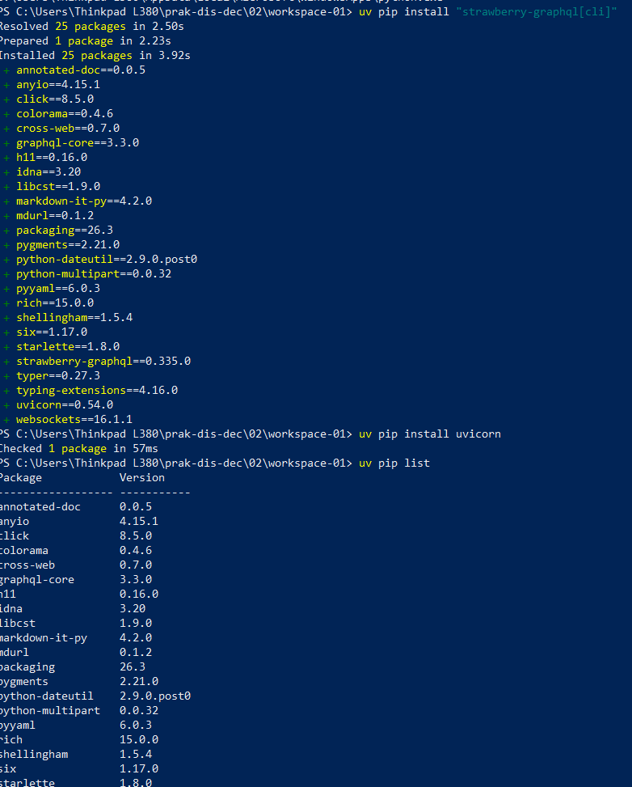

#### 3. Membuat dan menjalankan server

Server pada [`schema.py`](workspace-01/schema.py) mendefinisikan tipe `Book` dengan field `title` dan `author`. Query root menyediakan field `books` yang mengembalikan dua data buku:

- **Indahnya Senja Sore** — Indah Purwati
- **Aku Berkelana** — Ainka Lana

Aplikasi Strawberry dibuat dari schema tersebut. Server dijalankan dari direktori `workspace-01` dengan host loopback:

```powershell
uvicorn schema:app --host 127.0.0.1 --port 8000
```

Jika diperlukan untuk memastikan penggunaan interpreter environment yang aktif, server dapat dijalankan dengan:

```powershell
.\.venv\Scripts\python.exe -m uvicorn schema:app --host 127.0.0.1 --port 8000
```

Log Uvicorn menunjukkan server berjalan pada `http://127.0.0.1:8000`. Browser dapat digunakan untuk membuka antarmuka GraphiQL (pada tangkapan layar berada di root `http://127.0.0.1:8000/`); endpoint yang dipakai client adalah `http://127.0.0.1:8000/graphql`.

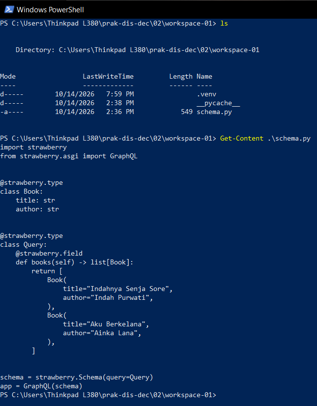

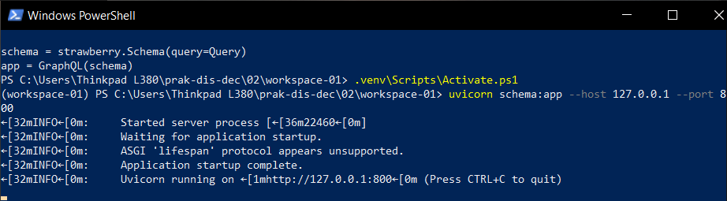

#### 4. Mengirim query dari GraphiQL

Query berikut meminta field judul dan penulis untuk setiap buku:

```graphql
{
  books {
    title
    author
  }
}
```

Respons GraphQL berisi dua buku yang sama dengan data yang didefinisikan pada schema. Ini menunjukkan bahwa query diterima dan diproses oleh server.

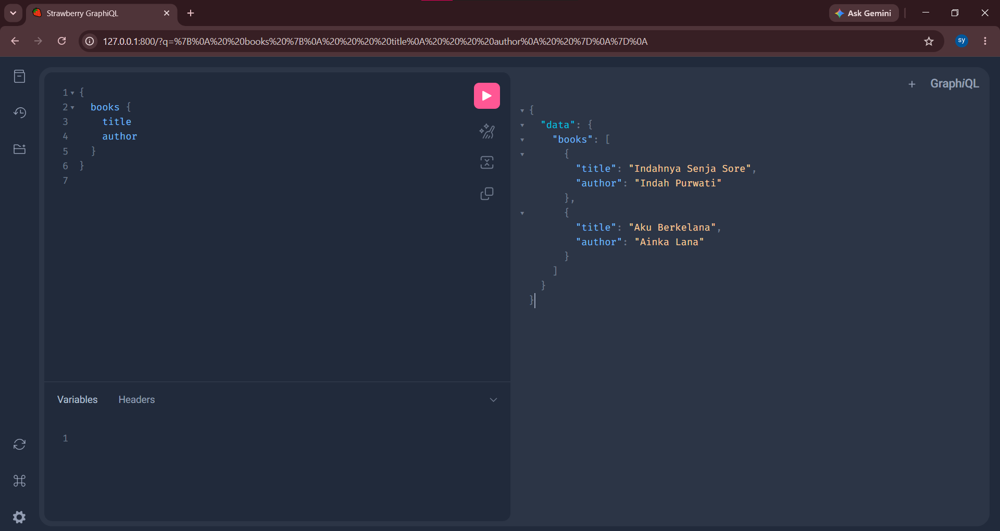

#### 5. Membuat dan menjalankan client Python

Client pada [`client.py`](workspace-01/client.py) menggunakan pustaka standar Python `urllib.request` untuk mengirim query sebagai HTTP POST ke `http://127.0.0.1:8000/graphql`. Query dibungkus sebagai JSON dengan header `Content-Type: application/json`; respons dibaca sebagai JSON dan dicetak dengan format yang mudah dibaca. Tidak diperlukan paket client GraphQL tambahan.

Urutan menjalankan client yang benar:

1. Buka PowerShell pertama pada direktori `workspace-01`, aktifkan environment, lalu jalankan server dan biarkan terminal tersebut tetap berjalan.
2. Buka PowerShell kedua pada direktori `workspace-01`, aktifkan environment, kemudian jalankan `python client.py`.
3. Untuk menghentikan server setelah pengujian, kembali ke terminal server dan tekan **Ctrl+C**.

Saat server aktif, client berhasil menerima data kedua buku dan mencetak respons JSON. Log server juga menunjukkan permintaan `POST /graphql` dengan status **200 OK**.

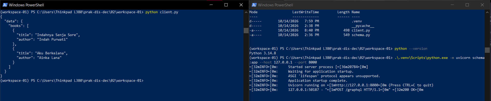

### Kendala dan penyelesaian

Percobaan menjalankan client saat server tidak aktif menghasilkan `ConnectionRefusedError`/`URLError` dengan keterangan koneksi ditolak. Hal ini terjadi karena tidak ada proses server yang sedang mendengarkan pada alamat dan port tujuan. Setelah server dinyalakan kembali, client dapat mengirim permintaan dan memperoleh respons.

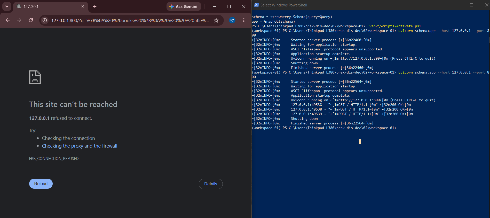

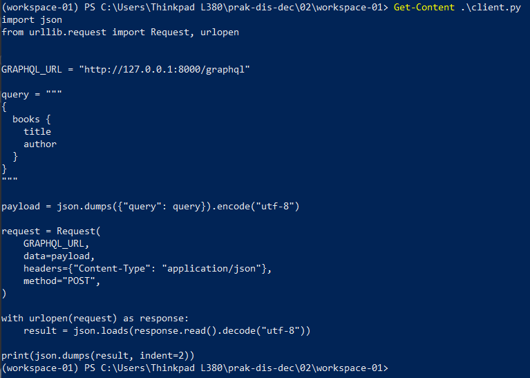

Tangkapan layar lain memperlihatkan kegagalan saat pengujian awal: client dijalankan dari direktori yang keliru, server sudah dihentikan, dan perintah PowerShell untuk mengolah JSON mengalami kesalahan parameter. Perintah relatif seperti `.\.venv\Scripts\python.exe` hanya merujuk ke environment jika dijalankan dari folder yang memiliki `.venv`; karena itu, menjalankannya dari folder induk menyebabkan executable tidak ditemukan.

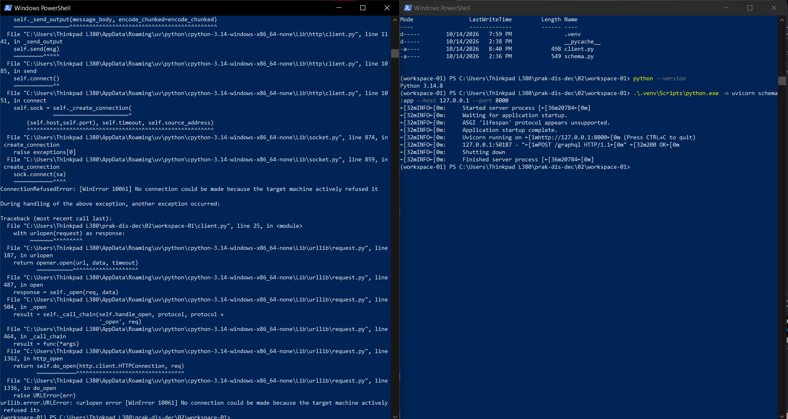

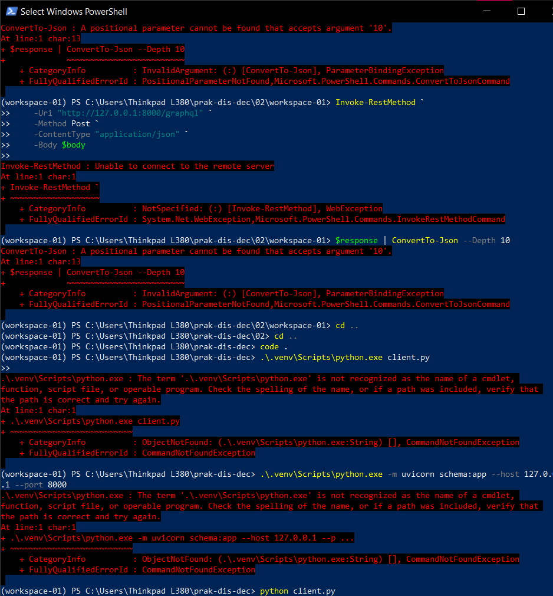

Perbaikan yang diterapkan adalah berpindah ke `02\workspace-01`, menjalankan server dari workspace itu dan membiarkannya aktif, lalu menjalankan `python client.py` dari workspace yang sama di terminal kedua. Dengan urutan dan direktori yang benar, client memperoleh respons GraphQL.

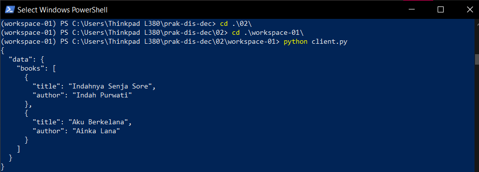

## Pembahasan

Pada bagian pertama, Task Manager memperlihatkan bahwa sistem operasi mengelola banyak proses aplikasi dan proses latar belakang secara bersamaan. PowerShell memberi cara untuk mengidentifikasi proses secara lebih spesifik. Penghentian berdasarkan PID menargetkan proses yang dimaksud; pemeriksaan sesudah penghentian mengonfirmasi bahwa Notepad tidak lagi berjalan. Saat aplikasi dimulai lagi, sistem memberikan PID baru.

Pada bagian kedua, schema Strawberry berperan sebagai kontrak data yang dapat diminta client. GraphiQL memudahkan pengujian secara interaktif, sementara `client.py` menunjukkan bahwa aplikasi biasa juga dapat berkomunikasi dengan server menggunakan HTTP dan format payload GraphQL. Client hanya meminta field yang diperlukan (`title` dan `author`), lalu server mengirimkan hasil dalam respons JSON.

Client dan server pada percobaan ini berjalan di komputer yang sama melalui `127.0.0.1`, sehingga ini merupakan uji komunikasi melalui endpoint jaringan lokal, bukan pengujian dua komputer fisik. Namun, pola request-response yang digunakan merupakan dasar komunikasi antarproses terdistribusi: client dan server berkomunikasi melalui pesan, bukan dengan berbagi memori. Ketika server tidak aktif, permintaan gagal; client membutuhkan server yang berjalan pada host, port, dan endpoint yang sesuai.

## Kesimpulan

Praktikum menunjukkan bahwa proses pada Windows dapat diamati dan dikelola melalui Task Manager maupun PowerShell. Notepad berhasil dijalankan, dikenali melalui nama proses dan PID, lalu dihentikan oleh sistem operasi tanpa menggunakan perintah keluar di dalam aplikasi. Ketika Notepad dijalankan kembali, proses memperoleh PID baru.

Server GraphQL berbasis Strawberry berhasil menyediakan data buku, dan query yang sama berhasil dijalankan melalui GraphiQL maupun client Python. Client mengirim HTTP POST ke endpoint GraphQL dan menerima respons JSON saat server aktif. Pengujian juga menunjukkan bahwa koneksi ditolak jika server tidak berjalan, serta bahwa direktori kerja dan interpreter environment harus sesuai. Praktikum ini memperlihatkan prinsip komunikasi client-server sebagai salah satu cara proses bertukar data tanpa shared memory.