# Laporan Praktikum 3 — Sinkronisasi pada Sistem Terdistribusi

## Identitas

- **Nama:** Apriliva Putri P
- **NIM:** 255410035
- **Kelas:** Informatika-1
- **Mata kuliah:** Praktikum Sistem Terdistribusi dan Terdesentralisasi

## Tujuan Praktikum

1. Memahami cara sinkronisasi waktu menggunakan NTP.
2. Memahami penggunaan vector clock untuk mencatat urutan kausal peristiwa.
3. Mengamati pengaruh eksekusi konkuren, race condition, dan deadlock pada program multithread.
4. Memahami konsep pemilihan leader pada algoritma Raft dan mencoba modul simulasinya.

## Dasar Teori

Sistem terdistribusi terdiri dari beberapa proses atau komputer yang berjalan secara independen dan berkomunikasi melalui jaringan. Tidak ada satu jam fisik yang sempurna untuk menentukan urutan seluruh peristiwa, dan urutan eksekusi proses konkuren juga tidak selalu dapat diprediksi. Karena itu, sistem terdistribusi memerlukan mekanisme untuk menyelaraskan waktu, menelusuri hubungan sebab-akibat, serta mengoordinasikan akses sumber daya dan kepemimpinan.

- **NTP (Network Time Protocol)** menyelaraskan jam komputer melalui pertukaran pesan dengan server waktu di jaringan. NTP memperhitungkan waktu perjalanan pesan untuk mengestimasi selisih waktu (*offset*) dan keterlambatan jaringan. **PTP (Precision Time Protocol)** juga menyelaraskan jam, umumnya dengan presisi lebih tinggi pada jaringan yang mendukungnya.
- **Vector clock** memberi setiap proses sebuah vektor penghitung. Proses menaikkan penghitung lokal pada peristiwa, menyertakan vektor saat mengirim pesan, dan saat menerima pesan menggabungkan nilai dengan operasi maksimum komponen per komponen sebelum menaikkan penghitung lokal. Perbandingan vektor menunjukkan hubungan *happens-before* atau peristiwa konkuren.
- **Race condition** terjadi ketika hasil bergantung pada urutan akses konkuren ke data bersama, khususnya ketika operasi baca–ubah–tulis tidak dilindungi sinkronisasi. *Lock* melindungi bagian kritis agar hanya satu thread mengubah data pada satu waktu.
- **Deadlock** terjadi ketika thread saling menunggu sumber daya yang sedang dipegang thread lain sehingga tidak ada yang dapat melanjutkan. Salah satu cara menghindarinya adalah menghilangkan kondisi *circular wait*, misalnya dengan urutan pengambilan lock yang konsisten atau tidak menahan satu lock sambil menunggu lock lain.
- **Raft** adalah algoritma konsensus yang mengatur pemilihan leader melalui *term*, *election timeout*, pemungutan suara, dan mayoritas. Leader mengirim *heartbeat* kepada follower. Simulasi pada praktikum ini disederhanakan sehingga tidak mewakili seluruh mekanisme Raft sebenarnya.

## 3.1 Sinkronisasi Waktu

### Tujuan dan proses

Pada praktikum ini saya menggunakan **NetTime** di Windows untuk menyinkronkan waktu dengan server NTP. NetTime bertindak sebagai klien: aplikasi menghubungi server waktu yang dikonfigurasi, mengukur pertukaran pesan, lalu menggunakan hasil estimasi selisih waktu untuk menyelaraskan jam sistem. Nilai *offset* menunjukkan perkiraan perbedaan jam komputer terhadap server, sedangkan *lag* menunjukkan keterlambatan jaringan yang terukur. Sinkronisasi dapat dijalankan kembali secara berkala.

### Hasil pengamatan

Pada tangkapan layar, NetTime menampilkan status **“Time is synchronized”**. Server `0.nettime.pool.ntp.org` berstatus **Good**, dengan offset **+10 ms**, lag **37 ms**, dan **Last Error: None**. Tiga server lain terlihat berstatus **Not Used** pada saat tangkapan layar diambil.

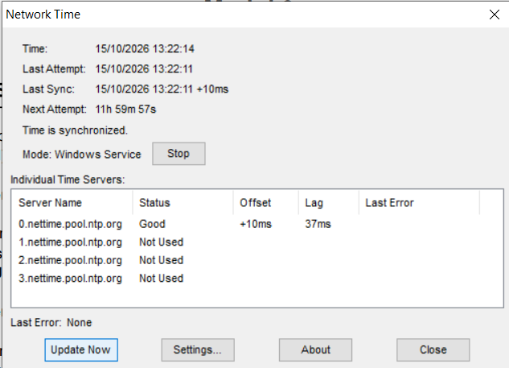

Hasil tersebut menunjukkan NetTime berhasil memperoleh respons dari server yang aktif dan melaporkan selisih waktu kecil. Nilai offset adalah hasil pengukuran pada saat itu, bukan jaminan bahwa jam akan selalu memiliki selisih yang sama.

## 3.2 Vector Clock

### Tujuan dan aturan algoritma

Vector clock digunakan untuk membandingkan urutan kausal peristiwa tanpa mengandalkan kesamaan jam fisik. Untuk proses `Pi`:

1. Setiap peristiwa lokal menaikkan komponen milik `Pi`.
2. Sebelum mengirim pesan, `Pi` menaikkan komponen lokal lalu mengirim salinan vektornya.
3. Saat menerima pesan, proses mengambil nilai maksimum dari vektor lokal dan vektor pesan untuk setiap komponen, kemudian menaikkan komponen lokal.
4. Vektor `A` terjadi sebelum `B` jika setiap komponen `A` kurang dari atau sama dengan komponen `B` dan setidaknya satu komponen lebih kecil. Jika keduanya tidak saling mendahului, keduanya konkuren.

### Hasil eksekusi program

Program [`vclocks.py`](./vclocks.py) memulai tiga proses dari `[0, 0, 0]`. Urutan pada tangkapan layar dapat dihitung manual sebagai berikut:

| Langkah | Peristiwa | Vector clock setelah peristiwa |
|---|---|---|
| 1 | P0 melakukan peristiwa lokal | P0 = `[1, 0, 0]` |
| 2 | P0 menaikkan clock sebelum mengirim ke P1 | P0 = `[2, 0, 0]` |
| 3 | P1 menerima pesan, menggabungkan vektor, lalu menaikkan komponen lokal | P1 = `[2, 1, 0]` |
| 4 | P2 melakukan peristiwa lokal | P2 = `[0, 0, 1]` |
| 5 | P1 menaikkan clock sebelum mengirim ke P2 | P1 = `[2, 2, 0]` |
| 6 | P2 menerima pesan dan menggabungkannya | P2 = `[2, 2, 2]` |

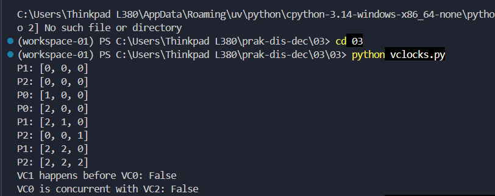

Secara manual, langkah-langkah tersebut menghasilkan nilai yang sama dengan program. Pada keluaran, `VC0 happens before VC1` bernilai **True** dan `VC1 happens before VC0` bernilai **False**. `VC0 is concurrent with VC2` bernilai **False** karena `VC0` pada pemeriksaan adalah `[2, 0, 0]`, dan vektor akhir P2 `[2, 2, 2]` tidak lebih kecil pada komponen mana pun serta lebih besar pada beberapa komponen. Jadi, `VC0` terjadi sebelum `VC2`; keduanya bukan konkuren.

### Modul dan contoh penggunaan

Class `VectorClock` telah dipisahkan sebagai modul di [`Modul3.2/vector_clock.py`](./Modul3.2/vector_clock.py). Contoh penggunaannya ada di [`Modul3.2/main_vc_demo.py`](./Modul3.2/main_vc_demo.py) dan dapat dijalankan dari folder praktikum dengan perintah:

```powershell
python Modul3.2/main_vc_demo.py
```

Program membuat dua proses, P0 dan P1. P0 melakukan peristiwa lokal, mengirim clock, lalu P1 menerima dan menggabungkannya. Hasil yang diharapkan adalah `P0: [2, 0]`, `P1: [2, 1]`, dan `P0 -> P1? True`.

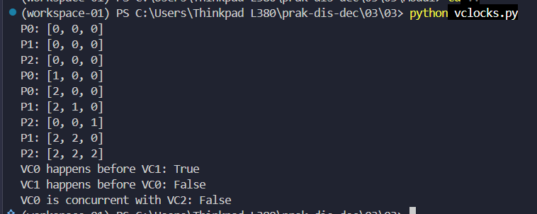

## 3.3 Problem Tanpa Sinkronisasi

### 3.3.1 Multithreading

Program menjalankan beberapa thread yang melakukan jeda dengan `sleep`, lalu mencetak waktu selesai. Gambar berikut memperlihatkan dua hasil pengamatan:

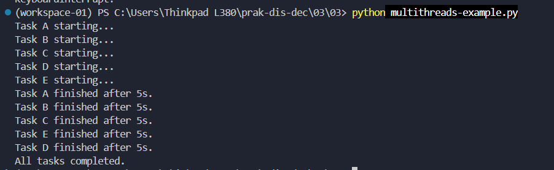

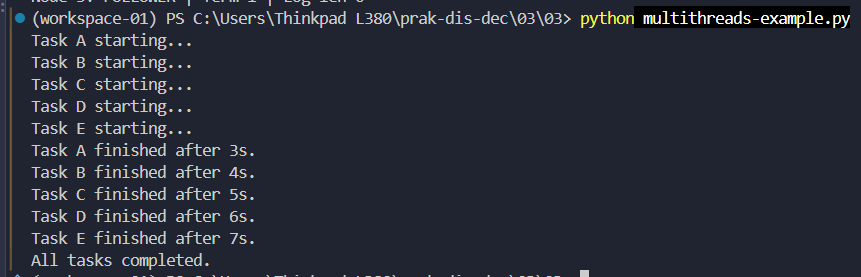

Semua pesan mulai muncul sebelum seluruh pekerjaan selesai karena thread berjalan konkuren. Urutan pencetakan dan waktu penyelesaian dapat dipengaruhi penjadwalan thread oleh sistem operasi dan kondisi eksekusi. Pada program yang memiliki durasi tunggu berbeda, durasi yang lebih pendek biasanya selesai lebih dahulu; jika beberapa thread memiliki durasi sama, urutannya dapat bervariasi. Karena itu, hasil tidak selalu mengikuti urutan thread dibuat atau dimulai. `join()` hanya membuat program utama menunggu sampai thread yang dipanggil selesai, bukan menentukan urutan kerja thread.

### 3.3.2 Data race / race condition

#### Program tanpa lock


Saldo awal adalah Rp100 dan dua thread masing-masing mencoba mengambil Rp80. Pada hasil tangkapan layar, kedua thread sama-sama mencetak pengambilan berhasil dan saldo akhir menjadi Rp20 serta **-Rp60**. Hal ini terjadi karena kedua thread dapat membaca saldo Rp100 dan sama-sama lolos pemeriksaan `balance >= amount` sebelum salah satunya selesai mengubah saldo.

Visualisasi pada foto menggambarkan dua thread membaca nilai bersama, menghitung pengurangan masing-masing, lalu menulis hasil yang saling bertabrakan. Pemeriksaan saldo dan pengurangan bukan satu operasi atomik; jeda di antara keduanya memberi kesempatan thread lain masuk. Akibatnya, pemeriksaan yang semestinya mencegah saldo negatif tidak lagi menjamin hasil yang benar. Keberadaan GIL pada Python tidak membuat rangkaian pemeriksaan dan perubahan ini otomatis atomik.

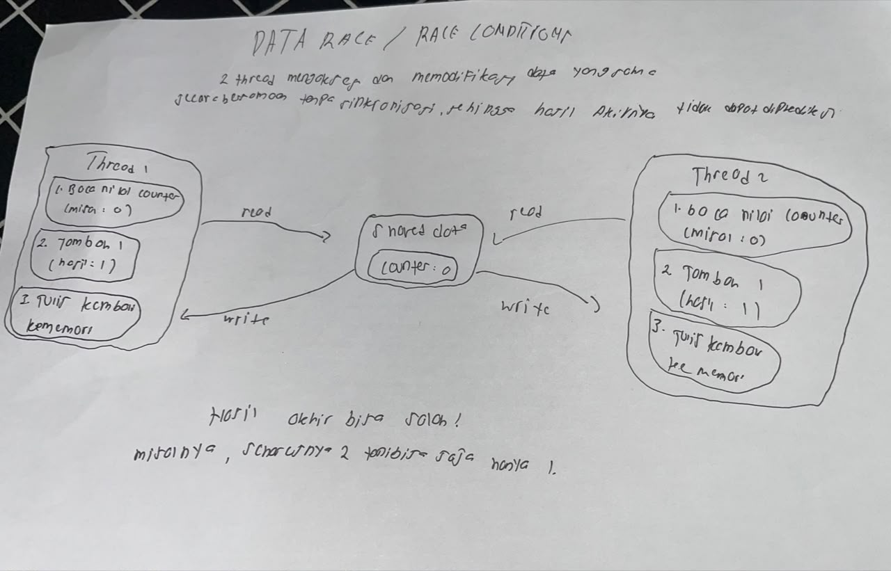

#### Program dengan lock


Pada versi ini, pemeriksaan saldo dan pengurangan berada di dalam `with counter_lock`. Hanya satu thread yang dapat memasuki bagian kritis dalam satu waktu. Thread yang menunggu baru memeriksa saldo setelah lock tersedia; saat itu saldo sudah Rp20 sehingga pengambilan kedua ditolak. Keluaran menunjukkan hanya satu pengambilan berhasil dan saldo menjadi Rp20.

### 3.3.3 Deadlock

#### Program deadlock

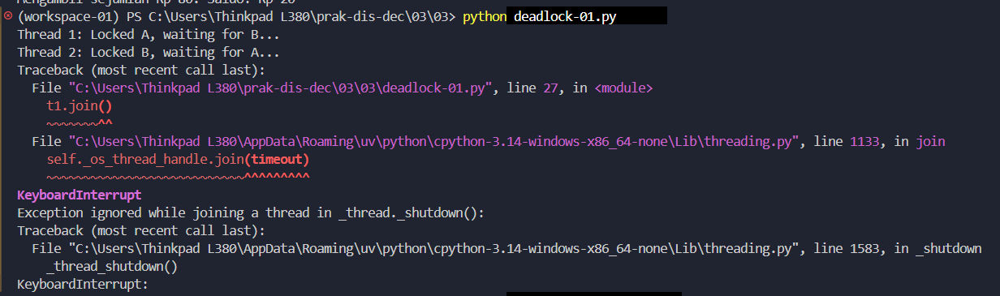

Thread 1 mengambil Lock A lalu menunggu Lock B, sementara Thread 2 mengambil Lock B lalu menunggu Lock A. Masing-masing menahan sumber daya yang dibutuhkan thread lain. Tidak ada thread yang dapat melanjutkan untuk melepaskan lock, sehingga program tertahan pada `join()` sampai dihentikan secara manual. Tangkapan layar memperlihatkan pesan kedua thread sedang menunggu dan `KeyboardInterrupt` setelah proses dihentikan.

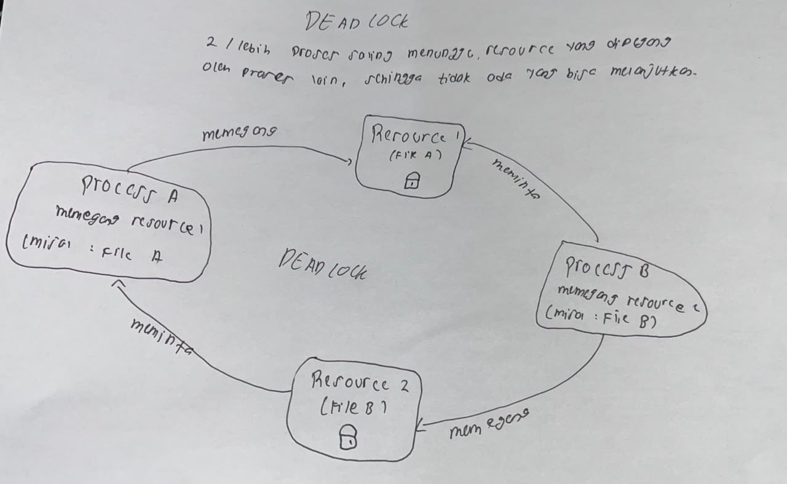

#### Program yang menghindari deadlock

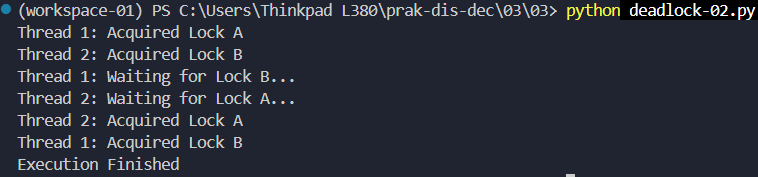

Pada `deadlock-02.py`, setiap thread melepaskan lock pertama sebelum mencoba mengambil lock kedua. Dengan demikian, tidak ada thread yang menahan Lock A sambil menunggu Lock B, atau sebaliknya. Kondisi *circular wait* terputus sehingga thread dapat bergantian mengambil lock dan program berakhir dengan `Execution Finished`.

Catatan: program ini **tidak menggunakan `acquire(timeout=5)`**. Deadlock dihindari oleh urutan pelepasan dan pengambilan lock tersebut, bukan oleh timeout. Karena lock pertama dilepas sebelum lock kedua diperoleh, contoh ini juga tidak membuat kedua sumber daya terkunci bersama dalam satu bagian kritis atomik.

## 3.4 Algoritma Raft

### Tujuan dan alur pemilihan leader

Raft menjaga koordinasi dan konsistensi melalui pemilihan satu leader untuk setiap term. Secara sederhana, semua node mulai sebagai **FOLLOWER**. Jika follower tidak menerima heartbeat hingga *election timeout*, node dapat menjadi **CANDIDATE**, menaikkan term, memilih dirinya sendiri, dan meminta suara kepada node lain. Candidate yang memperoleh suara mayoritas menjadi **LEADER**. Leader mengirim heartbeat agar follower mengetahui bahwa leader masih aktif. Jika leader gagal, timeout dapat memicu pemilihan berikutnya.

Visualisasi manual menunjukkan node leader berkomunikasi dengan para follower dan transisi status follower → candidate → leader. Pada Raft sebenarnya, pemilihan menggunakan aturan suara per term dan mayoritas; pesan log juga perlu direplikasi dan diakui sebelum dianggap konsisten.

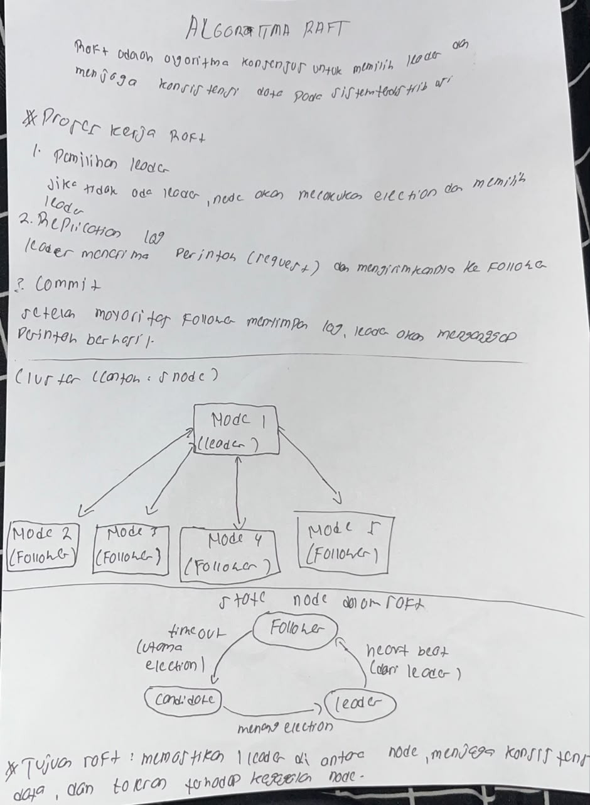

### Hasil program dan keterbatasan simulasi

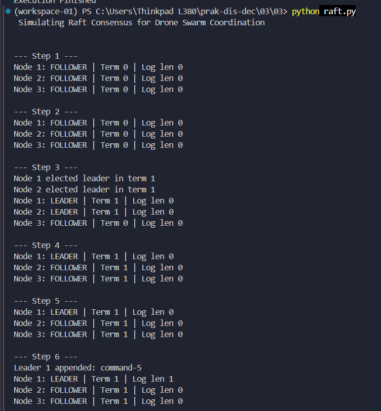

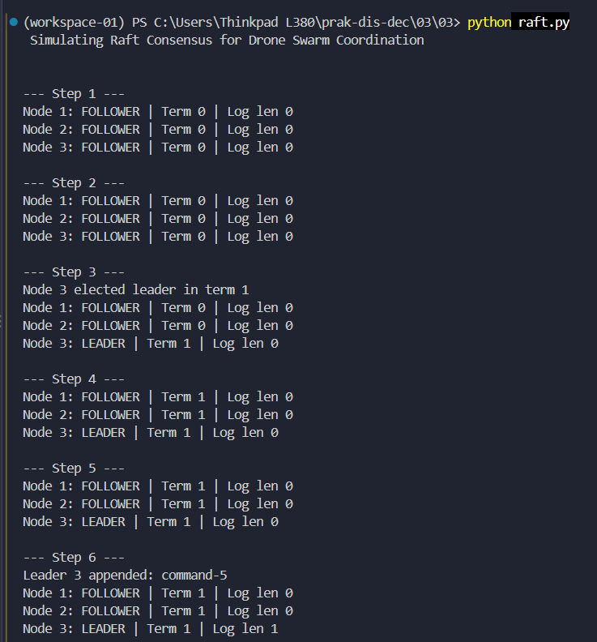

Keluaran menunjukkan node awalnya berstatus FOLLOWER, kemudian salah satu node dapat berstatus LEADER pada term 1. Pada salah satu tangkapan layar `raft.py`, Node 1 dan Node 2 sama-sama tercetak sebagai LEADER pada term 1. Ini merupakan batasan simulasi, bukan perilaku yang diharapkan dari implementasi Raft yang benar.

Di dalam [`raft.py`](./raft.py) dan [`Modul3.4/raft_module.py`](./Modul3.4/raft_module.py), proses pemungutan suara disederhanakan: simulasi langsung menganggap semua node lain memberikan suara, tanpa mengirim dan memvalidasi `RequestVote` atau mencatat batasan satu suara per term. Karena beberapa candidate dapat memulai pemilihan, simulasi ini tidak menjamin hanya ada satu leader. Replikasi log dan heartbeat juga hanya dimodelkan sebagian. Dengan demikian, keluaran berguna untuk mengamati status dan term secara sederhana, tetapi tidak membuktikan konsensus Raft sesungguhnya.

### Modul dan contoh simulasi

Class `RaftNode` dan `State` disediakan dalam [`Modul3.4/raft_module.py`](./Modul3.4/raft_module.py), sedangkan pemanggilan simulasi ada di [`Modul3.4/main_raft_simulation.py`](./Modul3.4/main_raft_simulation.py). Jalankan dengan:

```powershell
python Modul3.4/main_raft_simulation.py
```

Program membuat tiga node, menjalankan sepuluh langkah simulasi, menampilkan status dan term setiap node, serta menambahkan entri ketika leader terpilih. Karena timeout menggunakan nilai acak, node yang memulai pemilihan dan urutan keluaran dapat berubah pada setiap eksekusi.

## Kesimpulan

Praktikum ini menunjukkan bahwa sinkronisasi waktu NTP membantu menyamakan jam komputer dengan server waktu, sedangkan vector clock mencatat urutan kausal tanpa mengandalkan jam fisik. Eksekusi multithread dapat menghasilkan urutan keluaran yang tidak sepenuhnya tetap. Race condition pada data bersama dapat menghasilkan saldo yang salah dan dapat dicegah dengan melindungi bagian kritis menggunakan lock. Deadlock muncul saat thread saling menunggu lock, dan contoh praktikum menghindarinya dengan tidak menahan lock pertama saat meminta lock kedua. Raft menggunakan pemilihan berbasis term dan mayoritas untuk memilih leader, tetapi simulasi praktikum menyederhanakan voting dan replikasi sehingga masih dapat menampilkan lebih dari satu leader dalam term yang sama.
