# Laporan Praktikum 04

## Identitas

- **Nama:** Apriliva Putri P
- **NIM:** 255410035
- **Kelas:** Informatika-1
- **Mata kuliah:** Praktikum Sistem Terdistribusi dan Terdesentralisasi

## Pertemuan Praktikum 04

## Judul Praktikum

Laporan Praktikum 04

## A. Tujuan Pembelajaran

1. Memahami konsep konsistensi dan replikasi data pada sistem terdistribusi.
2. Mempraktikkan konfigurasi streaming replication menggunakan PostgreSQL.
3. Memahami perbedaan fungsi server primary dan replica.
4. Menguji proses replikasi melalui operasi manipulasi data dan pemeriksaan status server.
5. Memahami konsep high availability dengan mempromosikan server replica menjadi primary.
6. Mengonfigurasi cluster Apache Ignite yang terdiri atas tiga node.
7. Menguji penyebaran data dan struktur tabel pada node-node Apache Ignite dalam satu cluster.

## B. Dasar Teori

### 1. Sistem Terdistribusi

Sistem terdistribusi merupakan sistem yang terdiri atas beberapa komputer atau proses yang saling berkomunikasi untuk menjalankan layanan. Data dan pemrosesan dapat tersebar pada beberapa node, sehingga diperlukan mekanisme untuk menjaga kesesuaian data serta koordinasi antar-node.

### 2. Konsistensi Data

Konsistensi data berkaitan dengan kesesuaian informasi yang disimpan atau ditampilkan oleh beberapa bagian sistem. Pada sistem yang menggunakan replikasi, perubahan data pada satu server perlu diterapkan ke server lain sesuai mekanisme replikasi yang digunakan.

### 3. Replikasi Data

Replikasi adalah proses menyalin dan memperbarui data pada lebih dari satu server atau node. Replikasi dapat membantu meningkatkan ketersediaan data dan mendukung pembagian beban akses. Hasil dan waktu penyebaran perubahan bergantung pada konfigurasi serta mekanisme replikasi yang digunakan.

### 4. Streaming Replication PostgreSQL

Berdasarkan modul, praktikum pertama menggunakan PostgreSQL 18.3 dengan dua instance, yaitu:

- Primary: server utama yang menerima operasi baca dan tulis.
- Replica (standby): server yang menerima perubahan dari primary dan menyediakan akses baca selama masih berada dalam status standby.

PostgreSQL menggunakan Write-Ahead Log (WAL) untuk merekam perubahan yang diperlukan dalam pemulihan dan replikasi. Dalam praktikum ini, proses replikasi akan dikonfigurasi menggunakan Docker Compose dan pg_basebackup.

### 5. High Availability

High availability (HA) merupakan upaya menjaga layanan agar tetap tersedia ketika terjadi kegagalan pada komponen sistem. Modul menjelaskan bahwa replica dapat dipromosikan menjadi primary menggunakan fungsi pg_promote() ketika primary tidak tersedia. Promosi ini merupakan tindakan operasional yang perlu dilakukan dengan hati-hati agar tidak terjadi dua server yang menerima penulisan secara bersamaan tanpa koordinasi.

### 6. Replikasi Master-Master Apache Ignite

Pada bagian kedua, modul menggunakan Apache Ignite 3 dengan tiga node dalam satu cluster. Berbeda dari pola primary-replica PostgreSQL yang dipraktikkan sebelumnya, model master-master dalam modul menempatkan node-node cluster untuk melayani operasi sesuai kemampuan dan konfigurasi cluster. Perubahan data serta struktur tabel akan diperiksa melalui koneksi ke beberapa node.

Praktikum ini menggunakan Docker Compose, Apache Ignite CLI, dan perintah SQL untuk menginisialisasi cluster serta memeriksa data.

## C. Alat dan Bahan

| No. | Alat atau bahan | Kegunaan |
| --- | --- | --- |
| 1 | Windows 10/11 | Sistem operasi yang digunakan untuk praktikum |
| 2 | Docker Desktop | Menjalankan container database dan cluster |
| 3 | PowerShell | Menjalankan perintah Docker dan mengelola direktori |
| 4 | Editor teks, misalnya VS Code atau Notepad | Membuat file konfigurasi dan SQL |
| 5 | Koneksi internet | Mengunduh image Docker dan file SQL |
| 6 | Browser | Membuka dokumentasi dan memeriksa endpoint Apache Ignite |

## D. Persiapan Lingkungan Windows

**Langkah 1. Memastikan Docker Desktop berjalan**

Buka Docker Desktop dari menu Start. Tunggu sampai proses inisialisasi selesai.

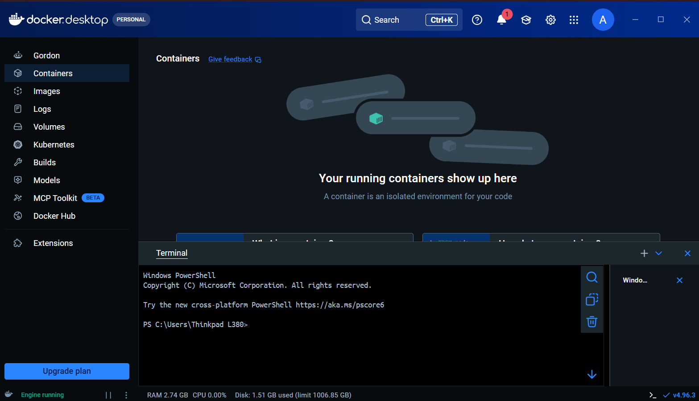

Penjelasan: Docker Desktop digunakan untuk menjalankan PostgreSQL dan Apache Ignite dalam container. Sebelum praktikum dimulai, Docker harus dapat menerima perintah dari terminal.

**Langkah 2. Memeriksa Docker melalui PowerShell**

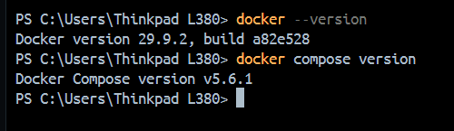

Penjelasan: Perintah pertama menampilkan versi Docker, perintah kedua memeriksa Docker Compose, sedangkan perintah ketiga memeriksa informasi daemon Docker. Jika Docker belum siap, perintah docker info biasanya menampilkan pesan kesalahan koneksi ke daemon. Pastikan masalah tersebut diselesaikan sebelum melanjutkan.

**Langkah 3. Membuat direktori praktikum**

Jalankan perintah berikut di PowerShell:

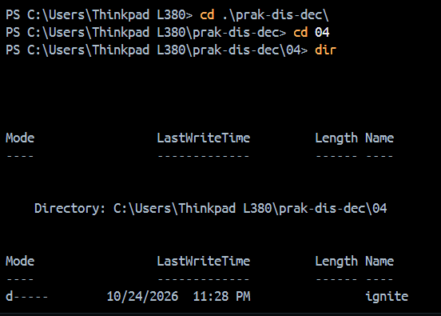

Penjelasan: Direktori streaming-replication digunakan untuk menyimpan konfigurasi PostgreSQL, sedangkan direktori ignite digunakan untuk konfigurasi Apache Ignite. Pemisahan ini mencegah file konfigurasi kedua praktikum tercampur.

## BAGIAN I — STREAMING REPLICATION MENGGUNAKAN POSTGRESQL

### E. Persiapan File PostgreSQL

**Langkah 4. Membuat file inisialisasi PostgreSQL**

Masuk ke direktori praktikum PostgreSQL:

Buat file 00_init.sql menggunakan Notepad:

```powershell
notepad .\00_init.sql
```

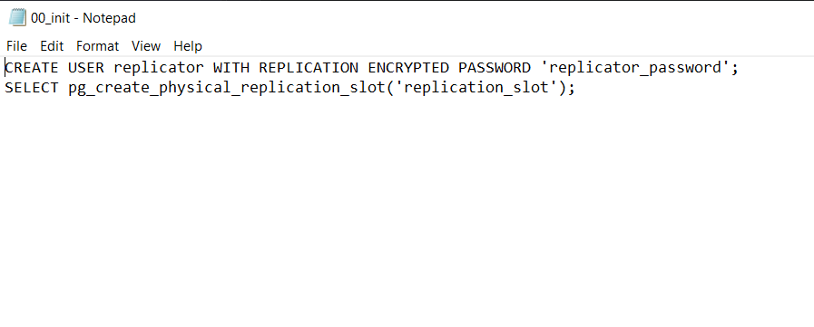

Penjelasan: File ini dijalankan saat PostgreSQL primary pertama kali diinisialisasi. Perintah pertama membuat akun replicator yang memiliki hak replikasi. Perintah kedua membuat slot replikasi fisik bernama replication_slot yang akan digunakan oleh server replica.

**Langkah 5. Membuat konfigurasi autentikasi PostgreSQL**

kita akan menggunakan file pg_hba.conf tersendiri.

Jalankan:

```powershell
notepad .\pg_hba.conf
```

Masukkan:

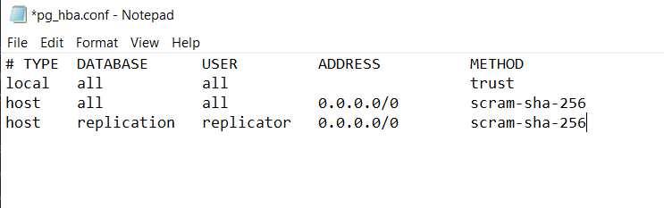

Penjelasan: File ini menentukan koneksi yang diperbolehkan ke PostgreSQL. Baris kedua mengizinkan autentikasi berbasis kata sandi untuk koneksi TCP, sedangkan baris ketiga mengizinkan akun replicator melakukan koneksi replikasi.

**Langkah 6. Membuat file Docker Compose**

Jalankan:

```powershell
notepad .\docker-compose.yaml
```

Masukkan konfigurasi berikut:

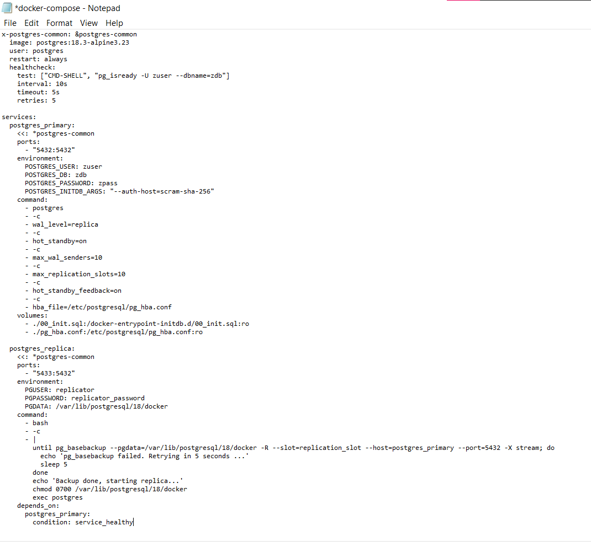

Penjelasan: Konfigurasi ini membuat dua container PostgreSQL. Container postgres_primary menjadi server utama dan membuka port Windows 5432, sedangkan postgres_replica menggunakan port Windows 5433. Replica mengambil salinan awal database menggunakan pg_basebackup, kemudian melanjutkan proses replikasi melalui WAL.

**Langkah 7. Memvalidasi konfigurasi Docker Compose**

Di direktori streaming-replication, jalankan:

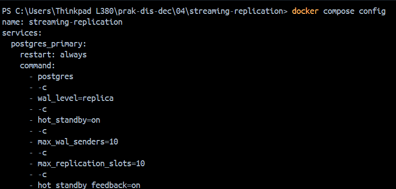

Penjelasan: Perintah tersebut memeriksa apakah file YAML dapat dibaca dan disusun menjadi konfigurasi Docker Compose. Jika terdapat kesalahan indentasi, penulisan properti, atau format konfigurasi, kesalahan biasanya akan ditampilkan pada tahap ini.

### F. Menjalankan dan Menguji Replikasi PostgreSQL

**Langkah 8. Menjalankan container PostgreSQL**

Jalankan perintah berikut:

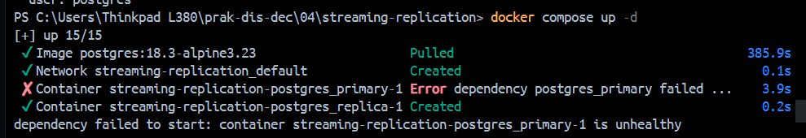
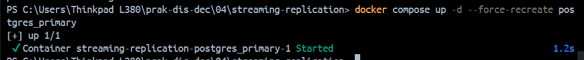

Penjelasan: Opsi -d menjalankan container di latar belakang sehingga PowerShell dapat digunakan kembali. Pada pelaksanaan pertama, proses dapat membutuhkan waktu lebih lama karena image harus diunduh dan replica perlu mengambil salinan awal data dari primary.

**Langkah 9. Memeriksa status container**

Jalankan:

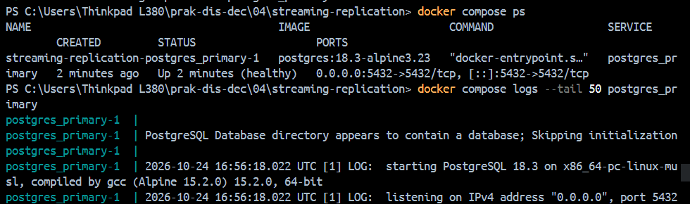
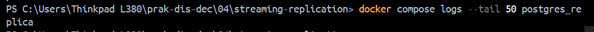

Penjelasan: Perintah docker compose ps menampilkan status container, sedangkan docker compose logs menampilkan pesan proses database. Periksa apakah primary sudah sehat dan apakah replica telah selesai mengambil salinan awal database.

**Langkah 10. Memeriksa status replikasi pada primary**

Jalankan perintah berikut untuk masuk ke PostgreSQL primary:

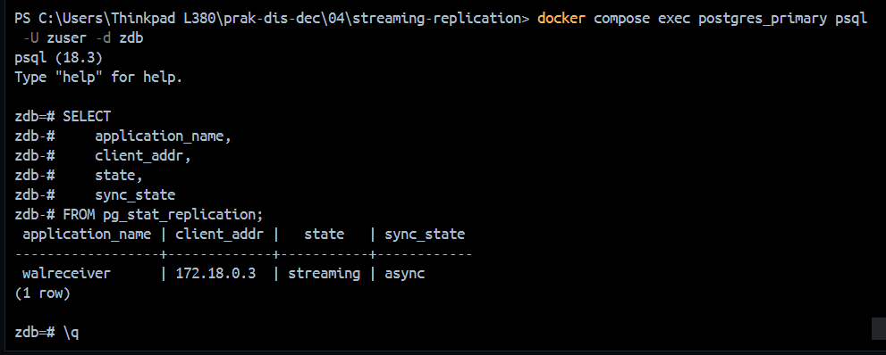

Penjelasan: Query tersebut digunakan untuk memeriksa koneksi replikasi yang diketahui oleh primary. Jika replica telah terhubung, biasanya akan terlihat informasi koneksi dan status pengiriman WAL. Nilai state dapat menunjukkan keadaan seperti streaming, sedangkan sync_state menunjukkan status sinkronisasi menurut konfigurasi PostgreSQL.

**Langkah 11. Memeriksa status replica**

Masuk ke replica, jalankan :

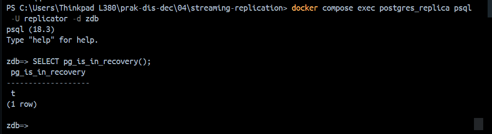

Penjelasan: Fungsi pg_is_in_recovery() digunakan untuk mengetahui apakah PostgreSQL masih berada dalam mode pemulihan. Nilai true menunjukkan server masih berada dalam mode standby/recovery, sesuai fungsi replica pada tahap ini.

**Langkah 12. Membuat tabel pada primary**

Masuk ke primary, jalankan:

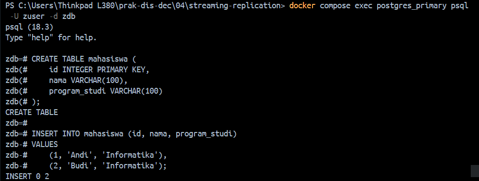
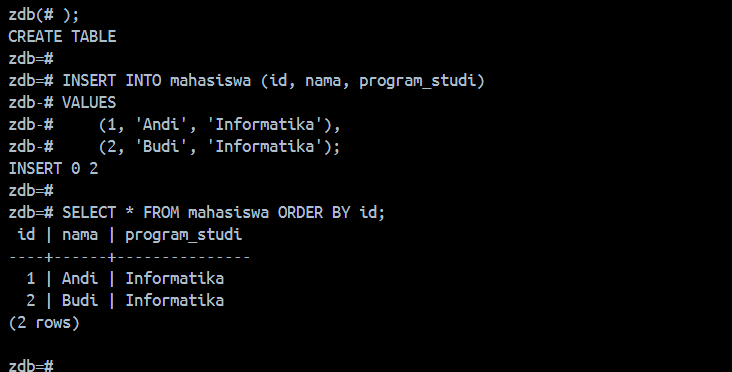

Penjelasan: Pada tahap ini dibuat tabel mahasiswa dengan tiga kolom, yaitu id, nama, dan program_studi. Dua baris data kemudian dimasukkan ke dalam tabel. Operasi penulisan dilakukan pada primary karena server tersebut menerima perubahan data dalam konfigurasi streaming replication ini.

**Langkah 13. Memeriksa hasil replikasi pada replica**

Keluar dari sesi primary jika masih terbuka, kemudian jalankan:

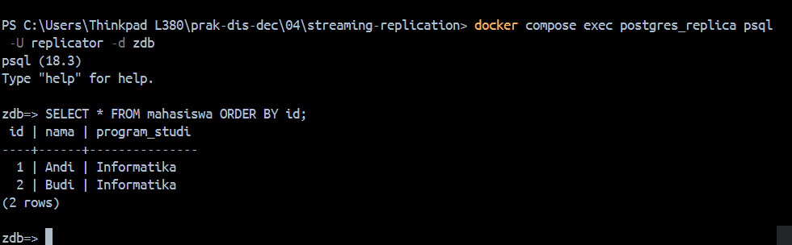

Penjelasan: Hasil query pada replica dibandingkan dengan hasil query pada primary. Jika kedua baris data tampil dengan isi yang sama, hal tersebut menjadi bukti bahwa perubahan tabel dan data telah diterapkan pada replica.

**Langkah 14. Menguji apakah replica menolak operasi tulis**

Pada sesi psql replica, jalankan:

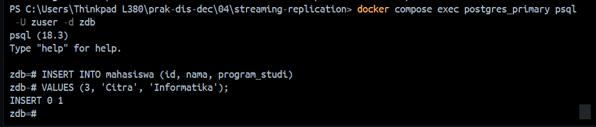

Penjelasan: Langkah ini digunakan untuk melihat perbedaan hak operasi antara primary dan replica. Dalam kondisi standby, perintah INSERT seharusnya ditolak karena replica tidak menerima operasi tulis biasa. Setelah pengujian, pastikan hasil yang benar-benar muncul dicatat pada laporan.

### G. Pengujian High Availability

**Langkah 15. Menghentikan container primary**

Kembali ke PowerShell, lalu jalankan:

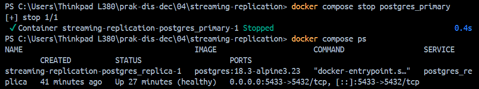

Penjelasan: Perintah pertama menghentikan container primary, sedangkan perintah kedua memeriksa kondisi container setelah penghentian. Tujuannya adalah menyimulasikan kegagalan atau tidak tersedianya server utama.

**Langkah 16. Mempromosikan replica menjadi primary**

Masuk ke container replica, jalankan :

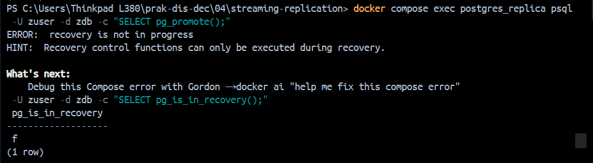

Penjelasan: Fungsi pg_promote() meminta server standby untuk keluar dari mode recovery dan menjadi primary. Jika promosi berhasil, pemeriksaan pg_is_in_recovery() diharapkan menghasilkan false.

**Langkah 17. Menghentikan seluruh container PostgreSQL**

Setelah pengujian selesai, jalankan:

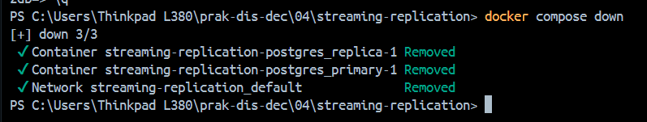

Penjelasan: Perintah ini menghentikan dan menghapus container yang dibuat oleh Docker Compose. Perintah tersebut tidak menghapus file konfigurasi lokal. Jika tidak ada volume data persisten yang didefinisikan, data pada container yang dihapus tidak boleh diasumsikan tetap tersedia setelah container dibuat ulang.

## BAGIAN II — REPLIKASI MASTER-MASTER MENGGUNAKAN APACHE IGNITE

### H. Persiapan File Apache Ignite

Pada bagian ini, modul menggunakan tiga node Apache Ignite yang tergabung dalam satu cluster. Kita akan menggunakan file konfigurasi dan kumpulan SQL yang disediakan melalui dokumentasi resmi Apache Ignite, sebagaimana dirujuk dalam modul.

**Langkah 18. Membuat direktori Apache Ignite**

Di PowerShell, jalankan:

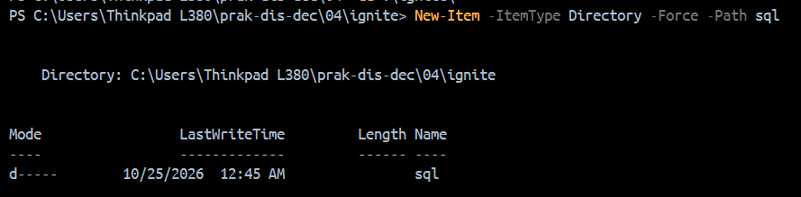

Penjelasan: Direktori ini digunakan untuk menyimpan file Docker Compose dan file SQL. Folder sql nantinya berisi perintah SQL yang akan dijalankan pada cluster Apache Ignite.

**Langkah 19. Mengunduh konfigurasi Docker Compose resmi**

Jalankan perintah berikut di PowerShell:

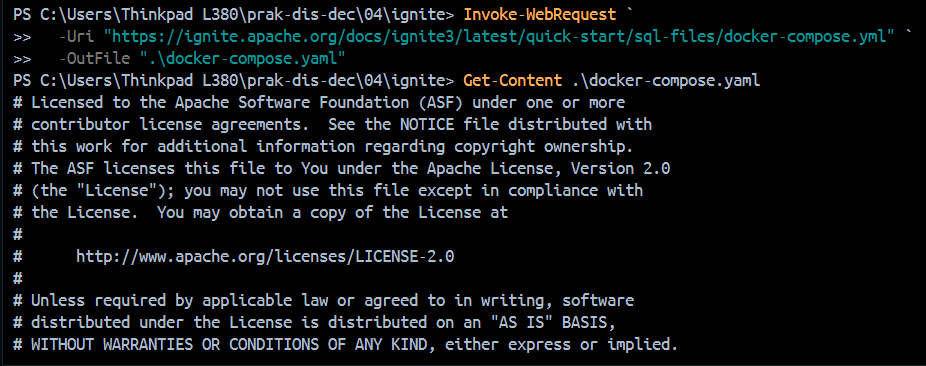

Penjelasan: File tersebut berisi konfigurasi layanan untuk menjalankan node-node Apache Ignite. Karena file berasal dari dokumentasi resmi yang dirujuk modul, periksa nama layanan, port, serta versi image yang tercantum sebelum menjalankannya.

**Langkah 20. Mengunduh file SQL**

Jalankan:

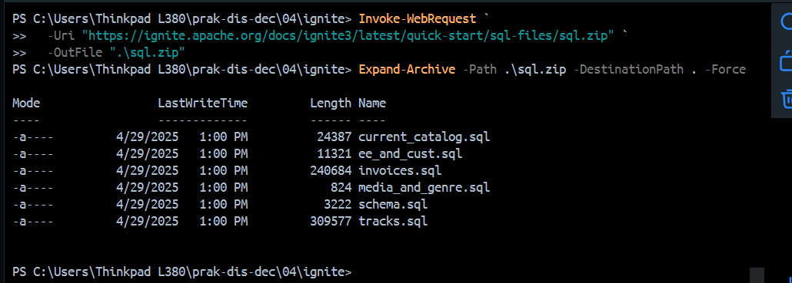

Penjelasan: File SQL berisi perintah untuk membuat skema dan tabel serta mengisi data yang digunakan dalam pengujian. Modul mencantumkan beberapa file, seperti schema.sql, tracks.sql, invoices.sql, dan current_catalog.sql. Hasil ekstraksi pada perangkat harus diperiksa untuk memastikan file benar-benar tersedia sebelum masuk ke tahap eksekusi.

### I. Menjalankan Cluster Apache Ignite

**Langkah 21. Memeriksa konfigurasi cluster**

Jalankan:

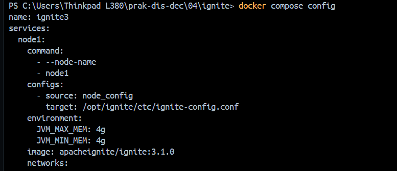

Penjelasan: Perintah ini memeriksa apakah file Docker Compose dapat dibaca. Pastikan konfigurasi memuat tiga node sesuai modul dan tidak terdapat kesalahan sintaks sebelum menjalankan container.

**Langkah 22. Menjalankan tiga node Apache Ignite**

Jalankan:

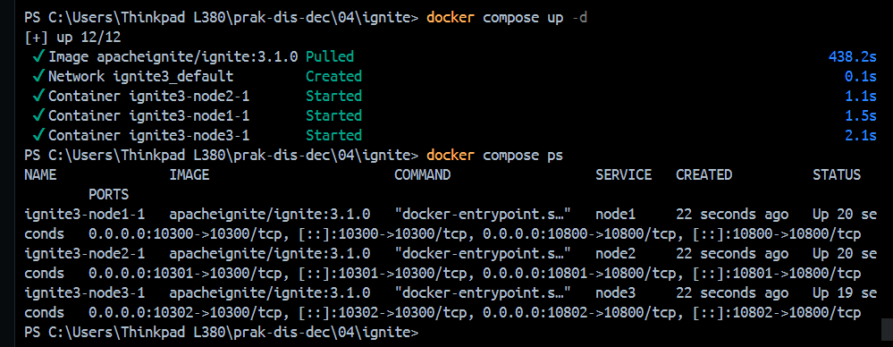

Penjelasan: Perintah pertama menjalankan layanan yang didefinisikan dalam Docker Compose, sedangkan perintah kedua menampilkan status masing-masing container. Periksa apakah ketiga node sudah berjalan sebelum melakukan inisialisasi cluster.

**Langkah 23. Memeriksa port yang digunakan**

Untuk memeriksa port yang dipublikasikan ke Windows, jalankan:

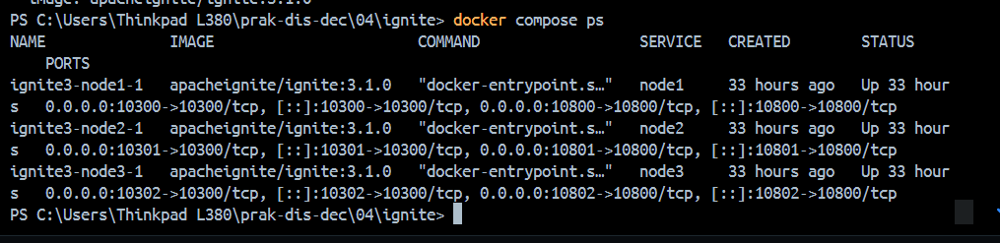

Penjelasan: Port yang dipublikasikan memungkinkan layanan dalam container diakses dari Windows. Cocokkan hasil yang tampil dengan konfigurasi Compose. Jangan mengasumsikan semua port tersedia apabila konfigurasi atau proses startup menunjukkan sebaliknya.

**Langkah 24. Memeriksa log cluster**

Jalankan:

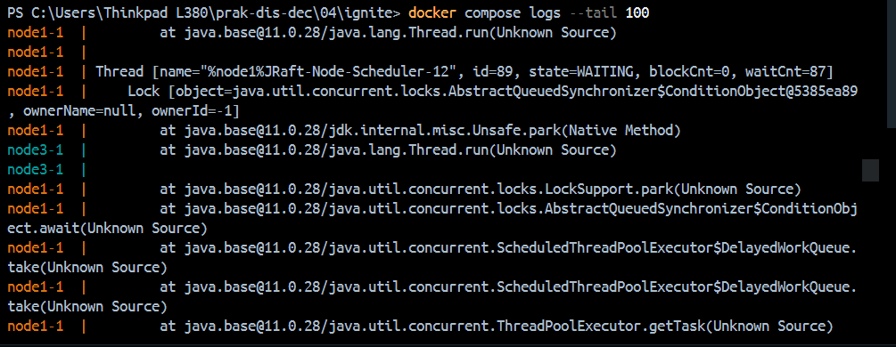

Penjelasan: Log digunakan untuk melihat proses inisialisasi node dan membantu menemukan kesalahan konfigurasi. Pada tahap ini, tujuan pemeriksaan adalah memastikan node telah berjalan dan siap untuk proses inisialisasi cluster.

### J. Inisialisasi Cluster Apache Ignite

**Langkah 25. Menjalankan Apache Ignite CLI**

Jika Docker Desktop sudah mengaktifkan fitur host networking, jalankan perintah berikut dengan menyesuaikan versi image dengan konfigurasi Compose:

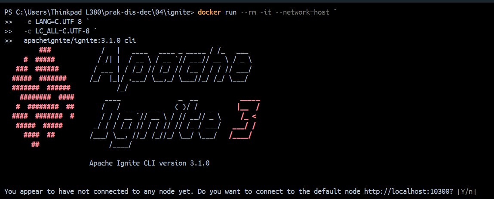

Penjelasan: Perintah tersebut menjalankan container sementara yang menyediakan CLI Apache Ignite. Opsi --rm menghapus container CLI setelah proses berakhir, sedangkan -it memungkinkan interaksi melalui terminal.

**Langkah 26. Menginisialisasi cluster**

Setelah CLI berhasil terhubung ke node yang dituju, jalankan perintah:

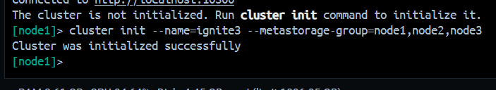

Penjelasan: Perintah tersebut menginisialisasi cluster dengan nama ignite3 dan menentukan tiga node sebagai kelompok penyimpanan metadata. Nama node harus sesuai dengan nama node yang didefinisikan pada konfigurasi Docker Compose. Jika nama node berbeda, perintah harus disesuaikan dengan konfigurasi yang benar.

### K. Eksekusi SQL dan Pengujian Replikasi

**Langkah 27. Menjalankan CLI dengan folder SQL yang di-mount**

Keluar dari CLI jika diperlukan. Jalankan perintah berikut dari direktori C:\praktikum\modul4\ignite:

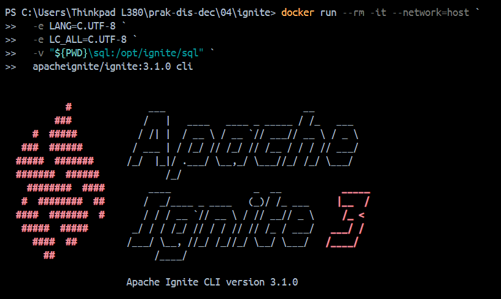

Penjelasan: Parameter -v menghubungkan folder SQL pada Windows dengan direktori /opt/ignite/sql di dalam container. Dengan demikian, file SQL yang berada pada komputer dapat diakses dari lingkungan CLI.

**Langkah 28. Menjalankan perintah SQL dari file**

Setelah CLI terhubung ke node, jalankan perintah SQL sesuai urutan file yang disediakan oleh modul dan dokumentasi Apache Ignite. File harus tersedia terlebih dahulu di direktori yang telah di-mount.

Untuk memeriksa tabel pada skema PUBLIC, masuk ke mode SQL, kemudian jalankan:

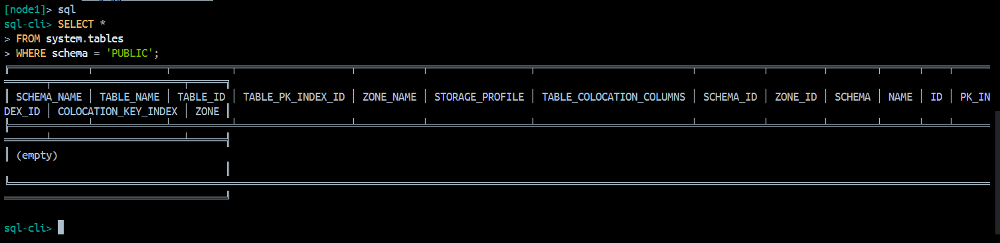

Penjelasan: Query tersebut digunakan untuk memeriksa tabel yang terdaftar pada skema PUBLIC. Hasilnya dapat digunakan untuk memastikan apakah struktur tabel dari file SQL telah tersedia pada cluster.

**Langkah 29. Memeriksa data dari node kedua**

Buka CLI atau sesi koneksi yang mengarah ke REST API node kedua, yaitu http://localhost:10301, sesuai konfigurasi port yang dipublikasikan.

Jalankan query pemeriksaan tabel yang sama:

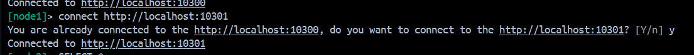
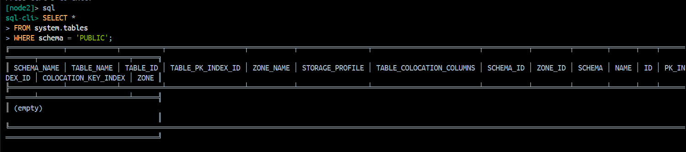

Penjelasan: Hasil dari node kedua dibandingkan dengan hasil dari node pertama. Jika struktur tabel yang sama terlihat, hasil tersebut mendukung bahwa metadata cluster tersedia melalui node kedua.

**Langkah 30. Memeriksa data dari node ketiga**

Ulangi pemeriksaan melalui REST API node ketiga, yaitu http://localhost:10302.

Jalankan:

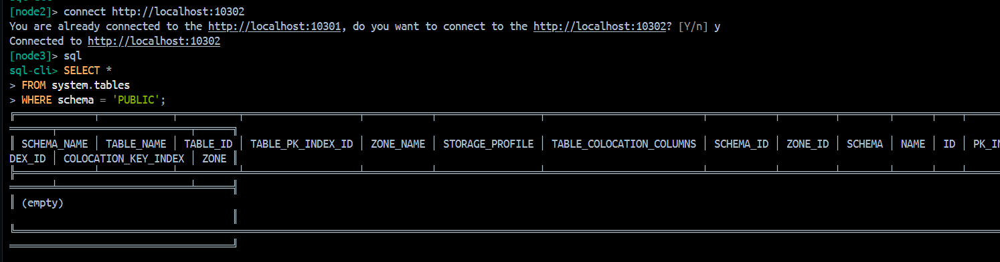

Penjelasan: Pemeriksaan ini dilakukan untuk melihat apakah struktur tabel juga tersedia melalui node ketiga. Dengan membandingkan hasil pada ketiga node, kita dapat menilai apakah cluster telah menyediakan akses terhadap metadata yang sama.

**Langkah 31. Menguji query data**

Jika file SQL telah berhasil dijalankan, pilih salah satu tabel yang benar-benar tersedia, kemudian jalankan query pembacaan, misalnya:

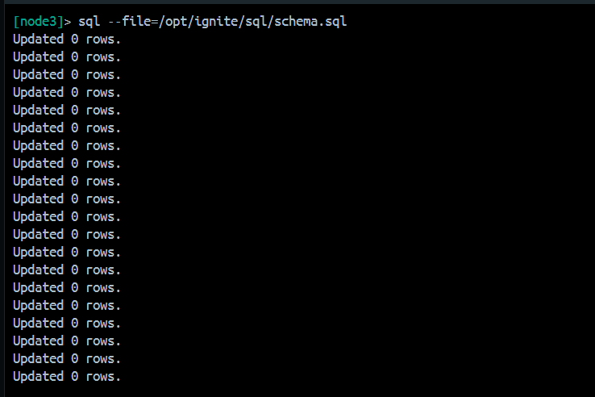
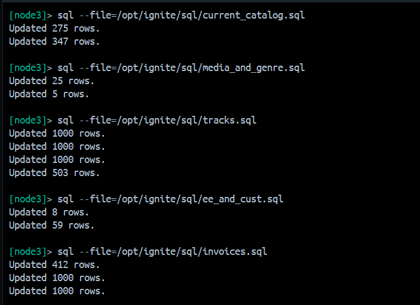
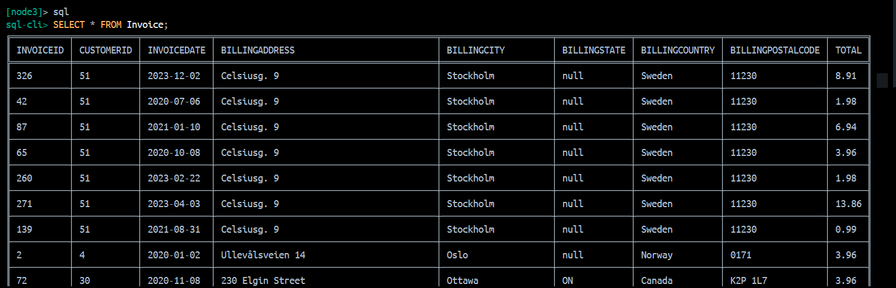

Penjelasan: Query digunakan untuk melihat data yang tersimpan dalam tabel. Hasil dari node pertama dan node lainnya dapat dibandingkan untuk memeriksa apakah data yang sama dapat diakses melalui beberapa node.

**Langkah 32. Menghentikan cluster Apache Ignite**

Setelah semua pengujian selesai, jalankan:

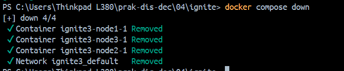

Penjelasan: Perintah ini menghentikan dan menghapus container yang dibuat oleh Docker Compose. Tujuannya agar sumber daya komputer tidak terus digunakan setelah praktikum selesai.

### M. Kesimpulan

Modul 4 membahas konsistensi dan replikasi dalam sistem terdistribusi melalui dua pendekatan. Pada PostgreSQL, streaming replication digunakan untuk meneruskan perubahan dari server primary ke server replica. Pengujian dilakukan melalui pemeriksaan status replikasi, perbandingan data, dan promosi replica untuk memahami konsep high availability.

Pada Apache Ignite, tiga node dikonfigurasikan dalam satu cluster. Inisialisasi cluster dan pemeriksaan struktur tabel melalui beberapa node digunakan untuk mempelajari bagaimana metadata dan data dapat diakses dalam lingkungan terdistribusi.
