# Laporan Praktikum 05

## Identitas

- **Nama:** Apriliva Putri P
- **NIM:** 255410035
- **Kelas:** Informatika-1
- **Mata kuliah:** Praktikum Sistem Terdistribusi dan Terdesentralisasi

## Pertemuan Praktikum 05

## Judul Praktikum

LAPORAN PRAKTIKUM MODUL 5

FAULT TOLERANCE

1. Tujuan Pembelajaran
Praktikum ini bertujuan untuk memahami penerapan konsep fault tolerance pada sistem terdistribusi, khususnya melalui mekanisme load balancing dan failure detection. Praktikum ini juga bertujuan untuk mengetahui cara menjalankan beberapa instance aplikasi menggunakan Docker Compose, mengatur pembagian permintaan menggunakan Nginx, serta menguji kondisi layanan melalui mekanisme heartbeat, retry, dan circuit breaker.

2. Dasar Teori
Fault Tolerance

Fault tolerance merupakan kemampuan suatu sistem untuk tetap beroperasi ketika salah satu komponen mengalami gangguan atau kegagalan. Dalam sistem terdistribusi, konsep ini diperlukan agar kegagalan pada satu bagian tidak langsung menyebabkan seluruh sistem berhenti bekerja.

Load Balancing

Load balancing merupakan mekanisme untuk membagi permintaan pengguna ke beberapa instance aplikasi. Pembagian ini bertujuan mengurangi beban pada satu server dan meningkatkan ketersediaan aplikasi. Pada praktikum ini, Nginx digunakan sebagai proxy load balancer, sedangkan aplikasi dibuat menggunakan framework Blacksheep dan dijalankan melalui Docker.

Failure Detection

Failure detection merupakan proses untuk mengetahui apakah suatu komponen masih aktif atau sudah mengalami kegagalan. Pada modul ini, proses tersebut dilakukan melalui beberapa pendekatan, yaitu heartbeat, retry, dan circuit breaker.

Heartbeat

Heartbeat merupakan mekanisme pemantauan aktivitas suatu komponen. Jika komponen pemantau tidak mendapatkan respons dalam waktu tertentu, komponen yang dipantau dapat dianggap mengalami kegagalan. Pada praktikum ini, pemeriksaan dilakukan menggunakan script check-server.py.

Retry

Retry merupakan mekanisme untuk mencoba kembali suatu permintaan ketika terjadi kegagalan. Pada praktikum ini digunakan library Tenacity untuk mengatur jumlah percobaan dan waktu tunggu sebelum permintaan dicoba kembali.

Circuit Breaker

Circuit breaker merupakan pola desain yang digunakan untuk mencegah kegagalan berantai dengan menghentikan sementara permintaan ke layanan yang terus mengalami kegagalan. Circuit breaker memiliki tiga status, yaitu closed, open, dan half-open. Status tersebut digunakan untuk menentukan apakah permintaan dapat diteruskan, diblokir sementara, atau diuji kembali.

3. Langkah Kerja dan Pembahasan
A. Load Balancing Aplikasi
Langkah 1 — Membuka folder source code
Buka Visual Studio Code, kemudian pilih File → Open Folder. Pilih folder src dari source code Modul 5 yang sudah diekstrak sebelumnya.

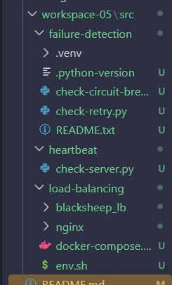

Penjelasan:

Pada tahap ini dilakukan pemeriksaan terhadap struktur source code yang digunakan dalam praktikum. Folder load-balancing berisi aplikasi Blacksheep dan konfigurasi Nginx, sedangkan folder heartbeat dan failure-detection berisi script untuk melakukan pengujian terhadap kondisi layanan.

Langkah 2 — Memeriksa Docker dan Docker Compose
Pastikan Docker Desktop sudah berjalan. Buka terminal PowerShell melalui menu Terminal → New Terminal pada Visual Studio Code.

Jalankan perintah berikut:
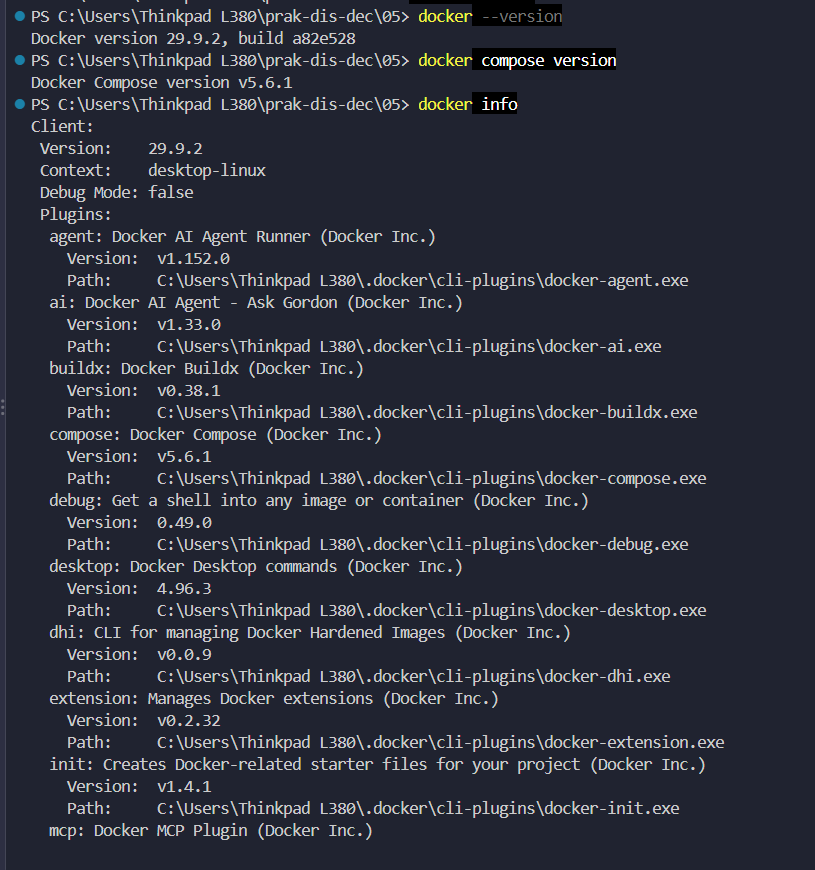

Penjelasan:

Perintah tersebut digunakan untuk memastikan Docker dan Docker Compose sudah terpasang serta dapat digunakan. Docker digunakan untuk menjalankan aplikasi dalam container, sedangkan Docker Compose digunakan untuk mengelola beberapa layanan dalam satu konfigurasi.

Screenshot 2 — Hasil pemeriksaan versi Docker dan Docker Compose.
Langkah 3 — Masuk ke direktori aplikasi Blacksheep

Jalankan perintah berikut:
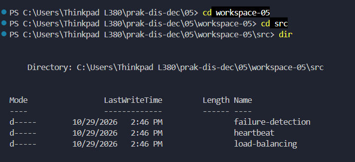

Penjelasan:

Folder blacksheep_lb merupakan direktori utama aplikasi web yang digunakan dalam praktikum. File dev.py digunakan untuk menjalankan aplikasi dalam mode pengembangan, sedangkan requirements.txt berisi daftar library yang diperlukan.

Langkah 4 — Membuat virtual environment Python
Masih berada di folder blacksheep_lb, jalankan dan Kemudian instal dependensi aplikasi::
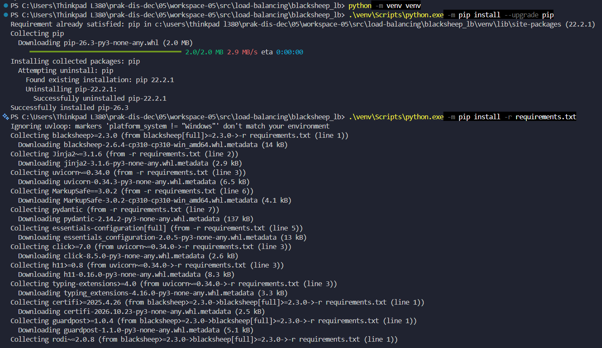

Penjelasan:

Virtual environment digunakan untuk menyediakan lingkungan Python khusus bagi aplikasi Blacksheep. Instalasi dependensi dilakukan berdasarkan daftar library yang terdapat pada file requirements.txt, sehingga kebutuhan aplikasi dapat dipisahkan dari instalasi Python utama pada Windows.

Langkah 5 — Menjalankan aplikasi Blacksheep
Setelah instalasi selesai, jalankan aplikasi dengan perintah:
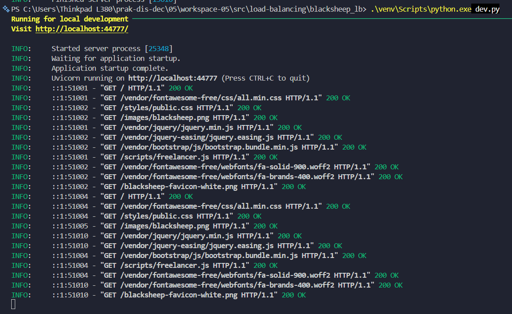

Penjelasan:

Perintah tersebut digunakan untuk menjalankan aplikasi web Blacksheep dalam mode pengembangan. Berdasarkan konfigurasi pada file dev.py, aplikasi menggunakan port 44777 secara default. Port tersebut nantinya digunakan untuk pengujian aplikasi sebelum dijalankan menggunakan Docker dan Nginx.

Langkah 6 — Mengakses aplikasi melalui browser
Buka browser, kemudian masukkan alamat:
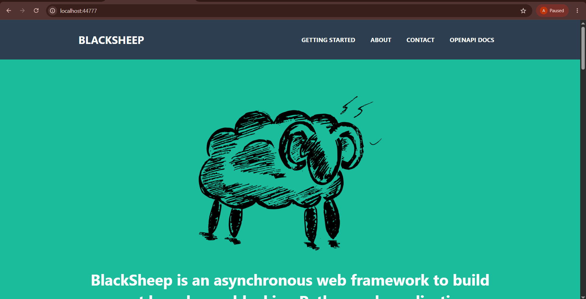

Penjelasan:

Pengujian melalui browser dilakukan untuk memastikan aplikasi dapat diakses secara langsung sebelum dikemas ke dalam container Docker. Jika halaman aplikasi berhasil ditampilkan, berarti aplikasi sudah dapat menerima permintaan melalui port 44777.

Langkah 7 — Memeriksa konfigurasi Dockerfile dan Nginx
Kembali ke Visual Studio Code. Periksa file berikut:
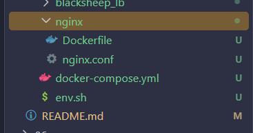
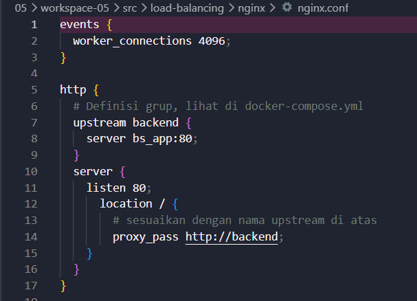

Penjelasan:

Konfigurasi tersebut menunjukkan bahwa Nginx menggunakan port 80 untuk menerima permintaan. Bagian upstream backend digunakan untuk menentukan layanan tujuan, yaitu bs_app pada port 80. Selanjutnya, proxy_pass meneruskan permintaan yang diterima Nginx menuju layanan aplikasi.

Dockerfile pada folder aplikasi digunakan untuk membangun image Blacksheep, sedangkan Dockerfile pada folder Nginx digunakan untuk membangun image Nginx dengan konfigurasi khusus dari praktikum.

Langkah 8 — Memeriksa konfigurasi Docker Compose
Masuk kembali ke direktori load-balancing, Periksa konfigurasi Docker Compose menggunakan perintah, lalu jalankan:
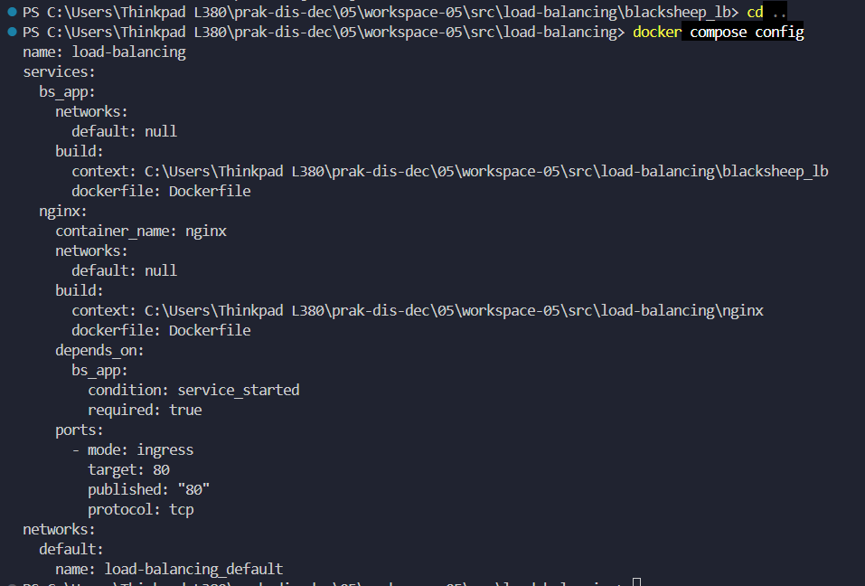

Penjelasan:

Perintah tersebut digunakan untuk memeriksa konfigurasi layanan sebelum dijalankan. Dalam file docker-compose.yml, terdapat dua layanan utama, yaitu bs_app sebagai aplikasi Blacksheep dan nginx sebagai proxy. Nginx juga menggunakan pemetaan port 80:80 agar aplikasi dapat diakses melalui port 80 pada komputer.

Langkah 9 — Menjalankan Docker Compose dengan dua instance aplikasi
Pastikan Docker Desktop masih berjalan. Kemudian jalankan:
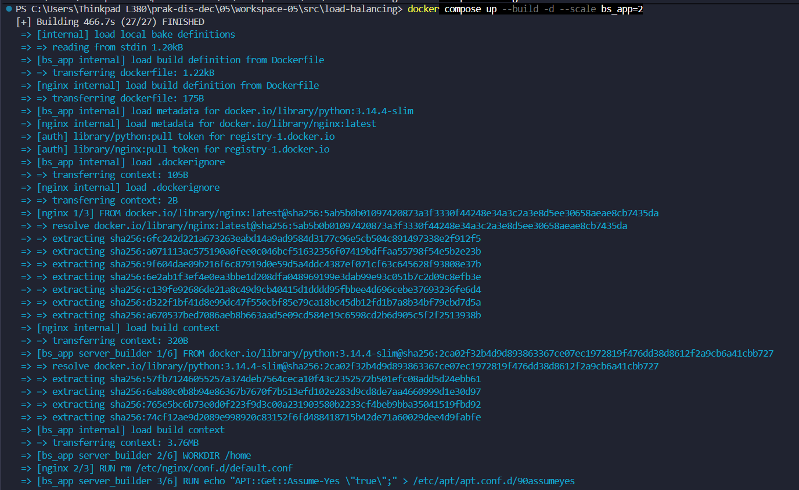
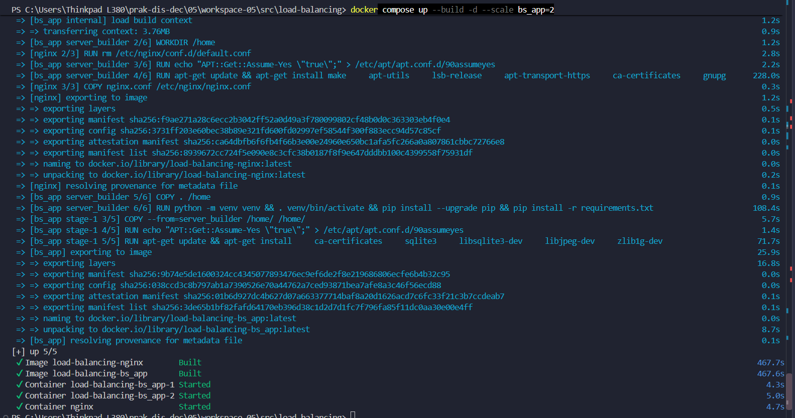

Penjelasan:

Perintah tersebut digunakan untuk membangun image sekaligus menjalankan layanan dalam mode background. Parameter --scale bs_app=2 digunakan untuk menjalankan dua instance aplikasi Blacksheep. Dengan demikian, Nginx dapat digunakan untuk meneruskan permintaan menuju layanan aplikasi yang dijalankan dalam beberapa instance.

Langkah 10 — Memeriksa container yang sedang berjalan
Jalankan perintah:
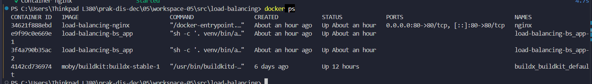

Penjelasan:

Perintah docker ps digunakan untuk menampilkan container yang sedang berjalan. Pada tahap ini, hasil yang diharapkan adalah terdapat dua container aplikasi Blacksheep dan satu container Nginx. Kedua instance aplikasi biasanya memiliki nama yang berakhiran bs_app-1 dan bs_app-2.

Langkah 11 — Mengakses aplikasi melalui Nginx
Buka browser dan masukkan alamat berikut:
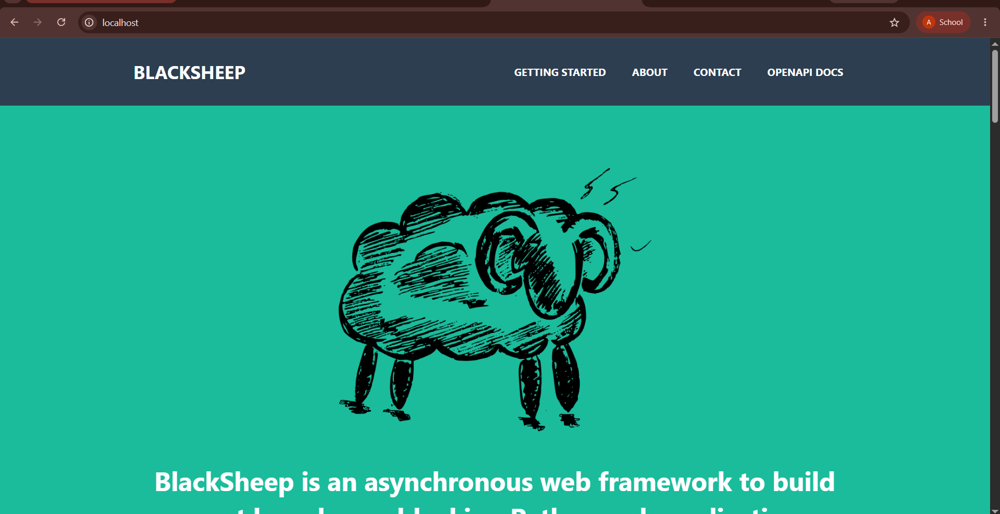

Penjelasan:

Pada tahap ini, permintaan dari browser tidak lagi langsung menuju port pengembangan Blacksheep, melainkan diterima oleh Nginx. Nginx kemudian meneruskan permintaan menuju layanan aplikasi berdasarkan konfigurasi upstream yang telah dibuat.

Langkah 12 — Memeriksa log untuk melihat pembagian permintaan
Kembali ke PowerShell dan jalankan:
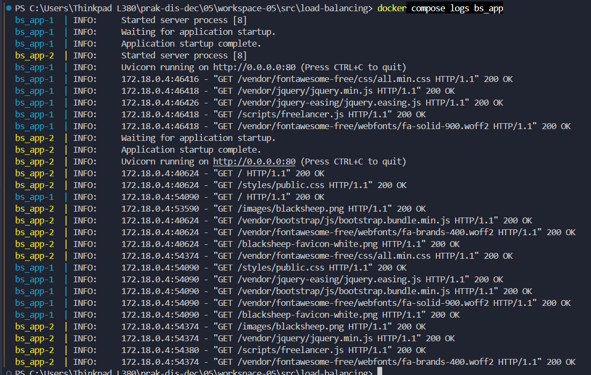

Penjelasan:

Log digunakan untuk mengamati aktivitas yang terjadi pada setiap instance aplikasi. Jika permintaan diterima oleh kedua instance, hal tersebut menunjukkan bahwa Nginx telah meneruskan permintaan menuju lebih dari satu instance aplikasi. Pemeriksaan ini penting untuk mengetahui apakah mekanisme load balancing berjalan sesuai tujuan praktikum.

Langkah 13 — Menghentikan container
Setelah pengujian load balancing selesai, jalankan:
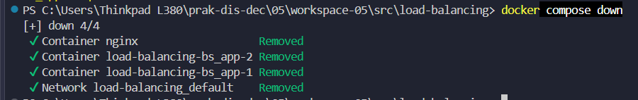

Penjelasan:

Perintah tersebut digunakan untuk menghentikan dan menghapus container serta jaringan yang dibuat oleh Docker Compose. Langkah ini dilakukan agar layanan load balancing tidak terus berjalan ketika praktikum beralih ke pengujian failure detection.

B. Failure Detection
Langkah 14 — Menyiapkan aplikasi untuk pengujian failure detection
Untuk pengujian failure detection, aplikasi Blacksheep harus dijalankan pada port 44777. Masuk ke folder blacksheep_lb, lalu jalankan aplikasi:
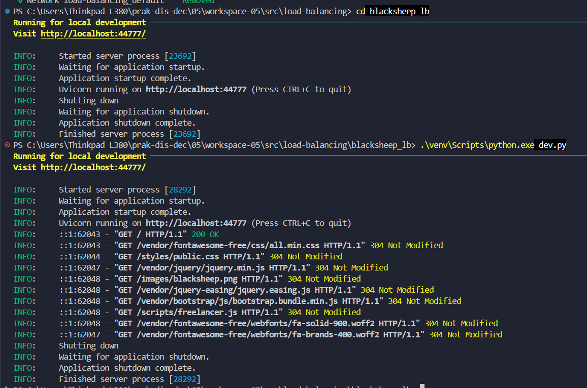

Penjelasan:

Aplikasi Blacksheep dijalankan kembali untuk digunakan sebagai layanan yang akan diperiksa oleh script failure detection. Pengujian dilakukan dalam dua kondisi, yaitu ketika aplikasi aktif dan ketika aplikasi tidak aktif, sehingga perbedaan respons dapat diamati.

Langkah 15 — Menguji heartbeat ketika aplikasi tidak aktif
Hentikan aplikasi Blacksheep terlebih dahulu dengan menekan Ctrl+C pada terminal tempat aplikasi berjalan.

Masuk ke folder heartbeat, lalu jalankan script:
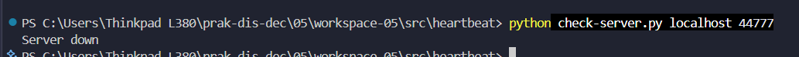

Penjelasan:

Pada kondisi ini, aplikasi Blacksheep tidak sedang berjalan sehingga port 44777 tidak menerima koneksi dari script. Script check-server.py melakukan pemeriksaan koneksi menggunakan socket. Jika koneksi gagal, script akan menampilkan pesan Server down.

Langkah 16 — Menguji heartbeat ketika aplikasi aktif
Jalankan kembali aplikasi Blacksheep menggunakan perintah:
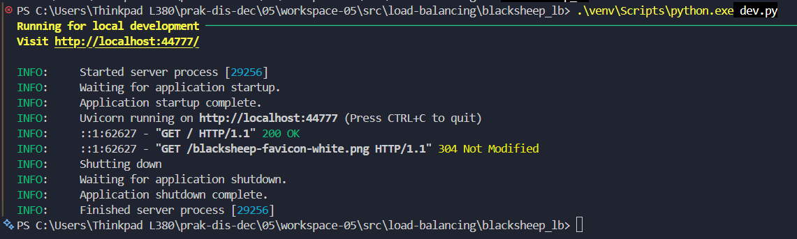

Setelah aplikasi berjalan, buka terminal lain dan masuk ke folder heartbeat. Jalankan kembali:
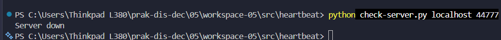
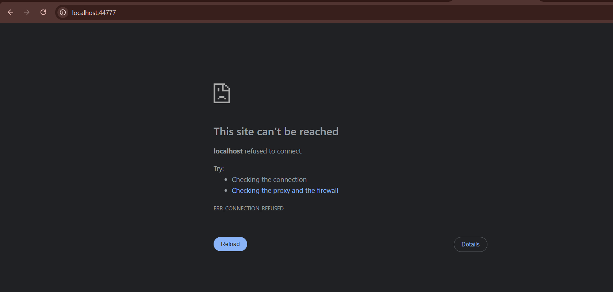

Penjelasan:

Ketika aplikasi aktif, port 44777 dapat menerima koneksi. Script check-server.py akan memperoleh koneksi sehingga menampilkan pesan Server up. Perbedaan hasil dengan pengujian sebelumnya menunjukkan bahwa script dapat membedakan kondisi server yang dapat diakses dan yang tidak dapat diakses.

Langkah 17 — Menginstal library untuk retry dan circuit breaker
Masuk ke folder failure-detection, Buat virtual environment khusus untuk pengujian:
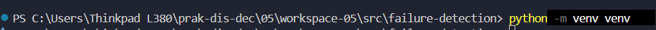

Instal library yang diperlukan:
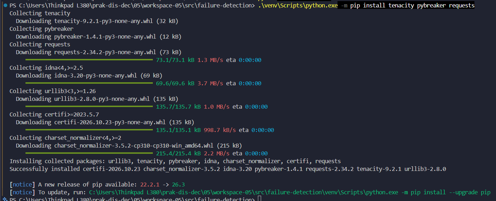

Penjelasan:

Pada tahap ini dilakukan instalasi library yang digunakan untuk menjalankan script pengujian. Tenacity digunakan untuk mengatur mekanisme retry, PyBreaker digunakan untuk menerapkan circuit breaker, sedangkan Requests digunakan untuk mengirimkan permintaan HTTP ke aplikasi Blacksheep.

Langkah 18 — Menguji retry ketika aplikasi aktif
Pastikan aplikasi Blacksheep masih berjalan pada port 44777. Kemudian jalankan script dari folder failure-detection:
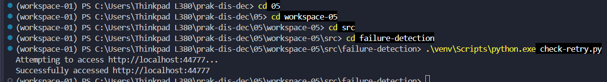

Penjelasan:

Script check-retry.py menggunakan library Tenacity untuk mengatur percobaan ulang ketika permintaan mengalami kegagalan koneksi. Jika aplikasi aktif dan dapat diakses, permintaan HTTP akan berhasil sehingga script menampilkan pesan Successfully accessed. Pada kondisi ini, mekanisme retry tidak perlu melakukan percobaan ulang.

Langkah 19 — Menguji retry ketika aplikasi tidak aktif
Hentikan aplikasi Blacksheep dengan menekan Ctrl+C pada terminal tempat aplikasi berjalan.

Kemudian jalankan kembali script:
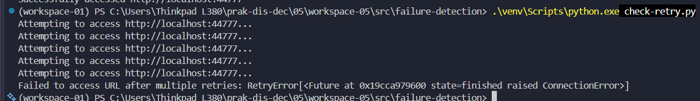

Penjelasan:

Ketika aplikasi tidak aktif, permintaan HTTP akan mengalami kegagalan koneksi. Library Tenacity akan mencoba kembali permintaan hingga maksimal lima kali sesuai konfigurasi stop_after_attempt(5). Waktu tunggu menggunakan mekanisme exponential backoff dengan jeda minimal empat detik dan maksimal sepuluh detik.

Jika seluruh percobaan gagal, script akan menampilkan pesan Failed to access URL after multiple retries. Hasil ini menunjukkan bahwa mekanisme retry memberikan kesempatan untuk mencoba kembali permintaan, tetapi tidak dapat menjamin keberhasilan jika layanan tetap tidak tersedia.

Langkah 20 — Menguji circuit breaker ketika aplikasi aktif
Jalankan kembali aplikasi Blacksheep pada port 44777. Setelah aplikasi aktif, masuk ke folder failure-detection dan jalankan:
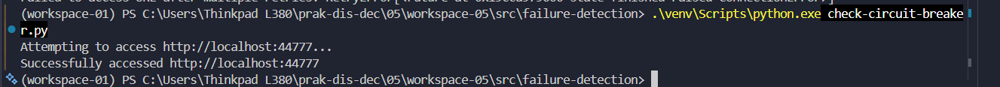

Penjelasan:

Script check-circuit-breaker.py menggunakan library PyBreaker untuk menerapkan pola circuit breaker. Ketika aplikasi dapat diakses, permintaan HTTP berhasil dan script menampilkan pesan Successfully accessed. Kondisi ini menunjukkan bahwa layanan dapat menerima permintaan tanpa mengalami kegagalan.

Langkah 21 — Menguji circuit breaker ketika aplikasi tidak aktif
Hentikan aplikasi Blacksheep dengan menekan Ctrl+C. Pastikan port 44777 tidak digunakan oleh aplikasi lain.

Jalankan kembali:
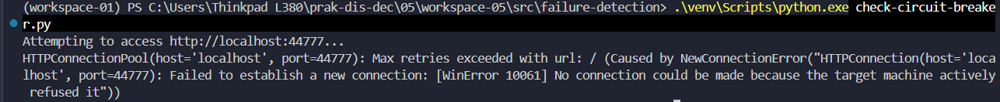

Penjelasan:

Ketika aplikasi tidak aktif, permintaan HTTP akan mengalami kegagalan koneksi. Pada script ini, circuit breaker dikonfigurasi menggunakan fail_max=4 dan reset_timeout=20. Artinya, circuit breaker memiliki ambang empat kegagalan dan waktu tunggu pemulihan selama 20 detik.

Namun, script yang disediakan hanya menjalankan satu pemanggilan fungsi HTTP dalam setiap eksekusi. Oleh karena itu, satu kali menjalankan script belum cukup untuk membuktikan bahwa circuit breaker telah melewati seluruh status closed, open, dan half-open. Pengujian ini tetap menunjukkan bagaimana kegagalan koneksi ditangani oleh fungsi yang dilindungi circuit breaker.

4. Pembahasan
Berdasarkan rangkaian praktikum pada Modul 5, terdapat dua materi utama yang dipelajari, yaitu load balancing dan failure detection.

Pada bagian load balancing, aplikasi Blacksheep dijalankan menggunakan Docker Compose dengan dua instance aplikasi. Nginx digunakan sebagai perantara untuk menerima permintaan dari browser dan meneruskannya menuju layanan aplikasi. Pemeriksaan container dan log dilakukan untuk mengetahui apakah kedua instance berjalan dan menerima permintaan.

Pada bagian heartbeat, script check-server.py digunakan untuk memeriksa koneksi ke server melalui port 44777. Ketika aplikasi tidak aktif, koneksi tidak dapat dilakukan sehingga script menampilkan Server down. Sebaliknya, ketika aplikasi aktif, script menampilkan Server up.

Pada pengujian retry, library Tenacity digunakan untuk mencoba kembali permintaan HTTP yang gagal. Ketika aplikasi aktif, permintaan dapat berhasil dilakukan. Namun, ketika aplikasi tidak aktif, script melakukan percobaan ulang sampai mencapai batas yang telah ditentukan.

Sementara itu, pada pengujian circuit breaker, library PyBreaker digunakan untuk menangani kegagalan permintaan. Pola ini bertujuan mencegah permintaan terus-menerus dikirimkan ke layanan yang sedang mengalami gangguan. Dengan adanya batas kegagalan dan waktu pemulihan, sistem dapat memberikan kesempatan kepada layanan untuk kembali normal.

5. Kesimpulan
Berdasarkan praktikum Modul 5, dapat disimpulkan bahwa fault tolerance merupakan bagian penting dalam sistem terdistribusi karena membantu sistem menghadapi kegagalan pada komponen tertentu. Load balancing menggunakan Nginx dan Docker Compose memungkinkan aplikasi dijalankan dalam beberapa instance sehingga permintaan dapat diteruskan melalui satu pintu masuk. Sementara itu, mekanisme heartbeat, retry, dan circuit breaker membantu mendeteksi serta menangani kegagalan layanan. Ketiga mekanisme tersebut memiliki fungsi yang berbeda, tetapi saling mendukung dalam menjaga ketersediaan dan kestabilan aplikasi.