# Laporan Praktikum 08

## Identitas

- **Nama:** Apriliva Putri P
- **NIM:** 255410035
- **Kelas:** Informatika-1
- **Mata kuliah:** Praktikum Sistem Terdistribusi dan Terdesentralisasi

## Pertemuan Praktikum 08

## Judul Praktikum

Laporan Praktikum 08

# LAPORAN PRAKTIKUM MODUL 8
# ARSITEKTUR MICROSERVICES UNTUK SISTEM TERDISTRIBUSI

**Mata Kuliah:** Praktikum Sistem Terdistribusi dan Terdesentralisasi  
**Program Studi:** Informatika  
**Nama:** [Nama Mahasiswa]  
**NIM:** [NIM]  
**Kelas:** [Kelas]

---

# 1. TUJUAN PEMBELAJARAN

Tujuan dari praktikum Modul 8 adalah:

1. Memahami konsep arsitektur Microservices dalam sistem terdistribusi.
2. Memahami penggunaan FastAPI untuk membangun RESTful API.
3. Memahami penggunaan SQLite sebagai media penyimpanan database.
4. Memahami penggunaan SQLModel untuk menghubungkan aplikasi Python dengan database.
5. Mampu membuat tabel database dengan tipe data INT, CHAR, VARCHAR, BOOLEAN, dan FLOAT.
6. Mampu memasukkan lima data ke dalam database menggunakan script Python.
7. Mampu membuat RESTful API untuk menampilkan seluruh data yang telah dimasukkan.
8. Mampu melakukan pengujian RESTful API menggunakan perintah curl.

# 2. DASAR TEORI

## 2.1 Microservices

Microservices merupakan salah satu arsitektur perangkat lunak yang membagi sebuah aplikasi menjadi beberapa layanan kecil yang dapat dikembangkan dan dijalankan secara terpisah. Setiap layanan memiliki fungsi tertentu dan dapat berkomunikasi dengan layanan lainnya melalui jaringan.

Dalam arsitektur ini, frontend berfungsi sebagai bagian yang berinteraksi langsung dengan pengguna, sedangkan backend menyediakan layanan yang dibutuhkan oleh frontend. Komunikasi antara keduanya dapat menggunakan REST API, GraphQL, maupun gRPC.

Pada praktikum ini digunakan REST API dengan FastAPI sebagai framework backend.

## 2.2 RESTful API

RESTful API merupakan antarmuka yang memungkinkan aplikasi saling berkomunikasi menggunakan protokol HTTP. REST API menyediakan beberapa metode untuk melakukan operasi terhadap data, seperti GET, POST, PUT, dan DELETE.

Pada praktikum ini digunakan metode GET untuk mengambil dan menampilkan seluruh data yang tersimpan di dalam database SQLite.

## 2.3 FastAPI

FastAPI merupakan framework berbasis Python yang digunakan untuk membangun aplikasi web dan REST API. FastAPI menyediakan fitur pengelolaan endpoint, validasi data, serta dokumentasi API secara otomatis.

Dalam praktikum ini, FastAPI digunakan sebagai backend yang menyediakan layanan untuk mengambil data dari database.

## 2.4 SQLite

SQLite merupakan sistem manajemen basis data relasional yang menyimpan data dalam sebuah file. SQLite tidak memerlukan server database terpisah sehingga dapat digunakan secara langsung oleh aplikasi.

Pada praktikum ini digunakan database `departemen-sdm.db` yang telah disediakan dalam source code Modul 8.

## 2.5 SQLModel

SQLModel merupakan pustaka Python yang digunakan untuk menghubungkan objek Python dengan database relasional. SQLModel menggabungkan konsep SQLAlchemy dan Pydantic sehingga dapat digunakan untuk mendefinisikan struktur tabel, melakukan validasi, serta mengelola data.

## 2.6 Tipe Data Database

Tipe data yang digunakan dalam praktikum ini meliputi:

| Tipe Data | Fungsi |
|---|---|
| INT | Menyimpan bilangan bulat. |
| CHAR | Menyimpan data karakter. |
| VARCHAR | Menyimpan data berupa teks dengan panjang bervariasi. |
| BOOLEAN | Menyimpan nilai benar atau salah. |
| FLOAT | Menyimpan bilangan desimal. |

SQLite menggunakan sistem type affinity sehingga deklarasi CHAR dan VARCHAR tidak membatasi panjang karakter secara ketat seperti pada beberapa DBMS lainnya.

## 2.7 Curl

Curl merupakan perangkat command line yang digunakan untuk melakukan komunikasi dengan server melalui protokol HTTP. Dalam praktikum ini, curl digunakan untuk mengirimkan permintaan GET kepada endpoint FastAPI dan menampilkan hasil respons dalam format JSON.

# 3. ALAT DAN BAHAN

1. Laptop dengan sistem operasi Windows.
2. Visual Studio Code.
3. PowerShell.
4. Python.
5. uv.
6. FastAPI.
7. SQLModel.
8. SQLite.
9. Curl.
10. Source code Modul 8.

# 4. LANGKAH KERJA DAN PEMBAHASAN

## 4.1 Persiapan Source Code

### Langkah 1. Mengekstrak source code Modul 8

Source code yang telah disediakan dalam bentuk arsip `src-08.tar.bz2` diekstrak terlebih dahulu. Setelah proses ekstraksi selesai, akan diperoleh folder `src` yang berisi beberapa file utama, yaitu:

- `service.py`
- `departemen-sdm.db`
- `requirements.txt`
- `.python-version`

**Screenshot:**

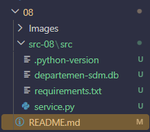

**Penjelasan:**

Pada tahap ini dilakukan ekstraksi source code yang telah disediakan dalam Modul 8. File tersebut berisi program FastAPI, database SQLite, serta daftar library yang dibutuhkan untuk menjalankan aplikasi.

Source code yang telah tersedia akan digunakan sebagai dasar pengerjaan sehingga tidak perlu membuat aplikasi baru dari awal. Pengembangan dilakukan dengan menambahkan tabel dan endpoint baru sesuai instruksi tugas praktikum.

### Langkah 2. Menyesuaikan konfigurasi Python pada Windows

Buka file `.python-version` yang terdapat di dalam folder `src`.

Pada source code bawaan, file tersebut berisi lokasi interpreter Python Linux. Karena praktikum dikerjakan menggunakan Windows, ubah isinya menjadi:

```text
3.14.4
```

Simpan perubahan tersebut.

**Screenshot:**

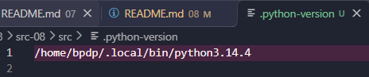

**Penjelasan:**

Penyesuaian dilakukan karena konfigurasi Python bawaan menggunakan lokasi interpreter yang berasal dari sistem operasi Linux. Pada praktikum ini digunakan Windows sehingga konfigurasi diubah menjadi nomor versi Python 3.14.4 agar dapat digunakan oleh uv pada lingkungan Windows.

### Langkah 3. Membuat virtual environment

Pastikan terminal PowerShell berada di dalam folder `src`, kemudian jalankan perintah:

```powershell
uv venv --python 3.14.4
```

Setelah proses selesai, aktifkan virtual environment menggunakan:

```powershell
.venv\Scripts\Activate.ps1
```

**Screenshot:**

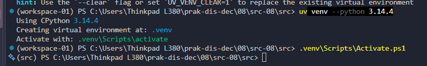

**Penjelasan:**

Virtual environment dibuat untuk menyediakan lingkungan Python khusus bagi proyek praktikum. Dengan adanya lingkungan virtual, seluruh library yang digunakan dapat dikelola secara terpisah dari instalasi Python utama sehingga tidak bercampur dengan proyek lainnya.

## 4.2 Instalasi Library

### Langkah 4. Menginstal dependensi dari requirements.txt

Jalankan perintah berikut:

```powershell
uv pip install -r requirements.txt
```

**Screenshot:**

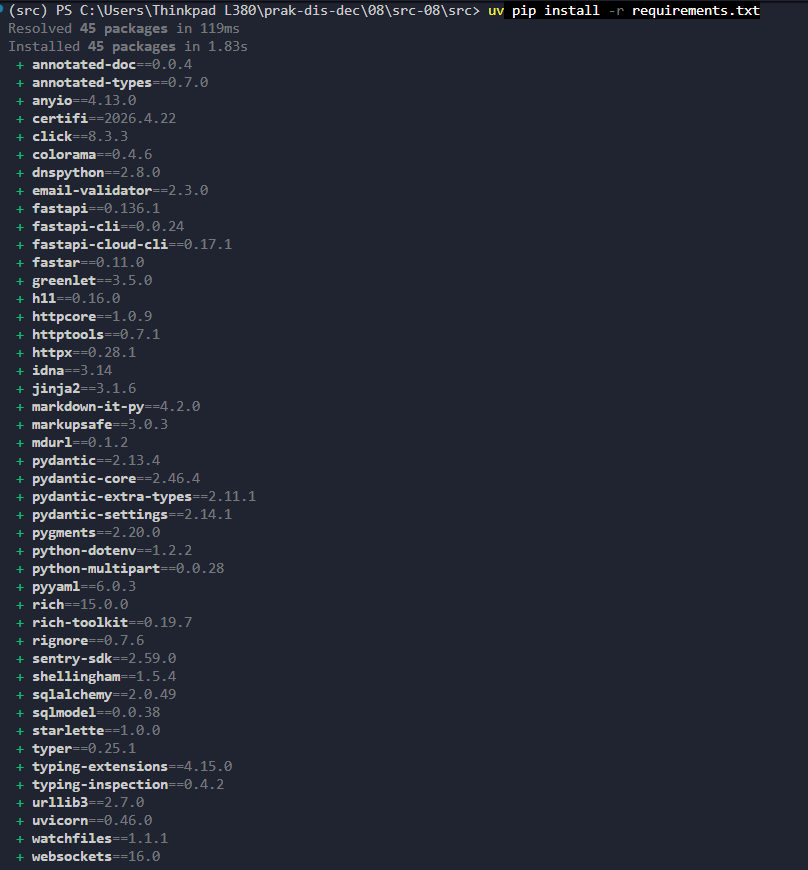

**Penjelasan:**

Instalasi dilakukan menggunakan file `requirements.txt` yang telah disediakan bersama source code Modul 8. File tersebut berisi daftar library beserta versi yang dibutuhkan oleh aplikasi.

Beberapa library utama yang digunakan adalah FastAPI untuk membangun REST API, SQLModel untuk mengelola database, SQLAlchemy sebagai pendukung operasi database, dan Uvicorn untuk menjalankan server aplikasi.

## 4.3 Memeriksa Database Bawaan

### Langkah 5. Memeriksa struktur database SQLite

Database yang digunakan dalam praktikum ini adalah `departemen-sdm.db`. Apabila SQLite Command-Line Tools sudah tersedia, jalankan:

```powershell
sqlite3 departemen-sdm.db
```

Kemudian tampilkan daftar tabel:

```sql
.tables
```

Periksa struktur tabel SDM:

```sql
.schema sdm
```

Selanjutnya tampilkan seluruh data:

```sql
SELECT * FROM sdm;
```

Untuk keluar dari SQLite:

```sql
.quit
```


**Screenshot:**

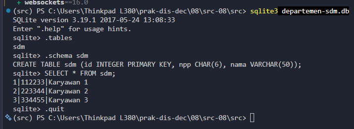

**Penjelasan:**

Pada tahap ini dilakukan pemeriksaan terhadap database bawaan yang telah disediakan dalam source code Modul 8. Database tersebut memiliki tabel `sdm` yang digunakan untuk menyimpan data sumber daya manusia.

Berdasarkan pemeriksaan database, tabel SDM memiliki kolom `id`, `npp`, dan `nama`. Database juga telah berisi tiga data karyawan. Database tersebut tetap digunakan dalam praktikum dan nantinya akan ditambahkan tabel baru bernama `produk`.

## 4.4 Menambahkan Tabel Baru pada Database

### Langkah 6. Menambahkan tipe data yang dibutuhkan

Buka file `service.py` yang telah disediakan.

Pada bagian import, tambahkan:

```python
from sqlalchemy import Column, CHAR, String
```

Sehingga bagian import menjadi:

```python
from typing import List, Optional
from fastapi import Depends, FastAPI, HTTPException
from sqlmodel import Field, Session, SQLModel, create_engine, select
from sqlalchemy import Column, CHAR, String
```

**Screenshot:**

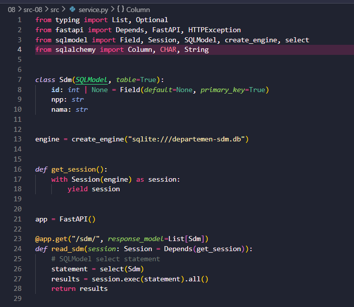


**Penjelasan:**

Penambahan import dilakukan untuk menyediakan tipe data CHAR dan VARCHAR melalui SQLAlchemy. Tipe tersebut digunakan dalam pembuatan struktur tabel produk agar sesuai dengan ketentuan tugas praktikum.

### Langkah 7. Membuat model tabel Produk

Masih pada file `service.py`, tambahkan class berikut setelah class `Sdm`:

```python
class Produk(SQLModel, table=True):
    id: int | None = Field(
        default=None,
        primary_key=True
    )

    kode_produk: str = Field(
        sa_column=Column(CHAR(10), nullable=False)
    )

    nama_produk: str = Field(
        sa_column=Column(String(100), nullable=False)
    )

    tersedia: bool

    harga: float
```

**Screenshot:**

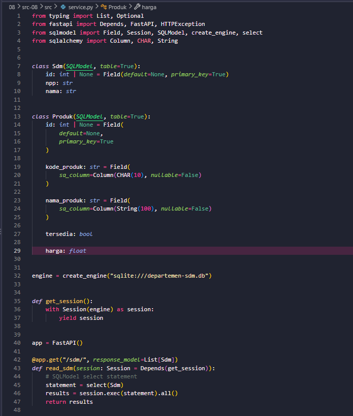

**Penjelasan:**

Pada tahap ini dibuat model baru bernama `Produk` menggunakan SQLModel. Model tersebut digunakan untuk membentuk tabel baru di dalam database SQLite.

Tabel produk memiliki lima kolom, yaitu:

1. `id` menggunakan tipe INT sebagai primary key.
2. `kode_produk` menggunakan tipe CHAR untuk menyimpan kode produk.
3. `nama_produk` menggunakan tipe VARCHAR untuk menyimpan nama produk.
4. `tersedia` menggunakan tipe BOOLEAN untuk menunjukkan status ketersediaan produk.
5. `harga` menggunakan tipe FLOAT untuk menyimpan harga produk dalam bentuk desimal.

Dengan struktur tersebut, tabel produk telah memenuhi ketentuan tipe data yang diminta pada tugas Modul 8.

## 4.5 Memasukkan Lima Data Menggunakan Python

### Langkah 8. Membuat file seed_produk.py

Buat file baru bernama `seed_produk.py` di dalam folder `src`.

Masukkan source code berikut:

```python
from sqlmodel import Session, select, SQLModel

from service import engine, Produk


# Membuat tabel berdasarkan model yang tersedia
SQLModel.metadata.create_all(engine)


# Data produk yang akan dimasukkan
data_produk = [
    Produk(
        kode_produk="PRD001",
        nama_produk="Laptop",
        tersedia=True,
        harga=7500000.50
    ),
    Produk(
        kode_produk="PRD002",
        nama_produk="Mouse",
        tersedia=True,
        harga=150000.00
    ),
    Produk(
        kode_produk="PRD003",
        nama_produk="Keyboard",
        tersedia=True,
        harga=275000.50
    ),
    Produk(
        kode_produk="PRD004",
        nama_produk="Monitor",
        tersedia=False,
        harga=1850000.00
    ),
    Produk(
        kode_produk="PRD005",
        nama_produk="Flashdisk",
        tersedia=True,
        harga=85000.75
    )
]


# Memasukkan data ke database
with Session(engine) as session:
    data_lama = session.exec(select(Produk)).all()

    if not data_lama:
        session.add_all(data_produk)
        session.commit()
        print("5 data produk berhasil dimasukkan.")
    else:
        print("Data produk sudah tersedia.")
```

**Screenshot:**

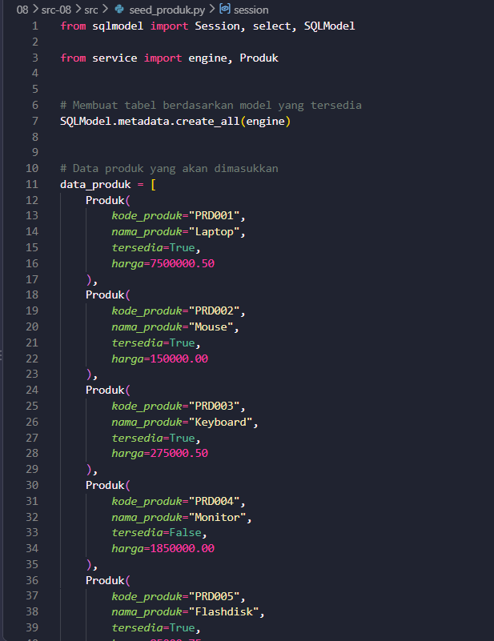

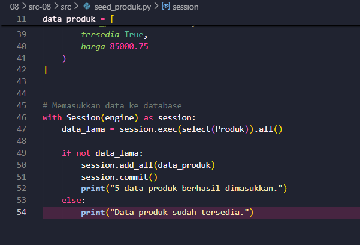

**Penjelasan:**

File `seed_produk.py` digunakan untuk memasukkan lima data produk ke dalam database menggunakan script Python.

Data yang dimasukkan terdiri dari kode produk, nama produk, status ketersediaan, dan harga. Setiap data dibuat menggunakan objek dari class `Produk`.

Sebelum data dimasukkan, program melakukan pemeriksaan menggunakan `select(Produk)` untuk memastikan bahwa data belum tersedia. Jika tabel masih kosong, seluruh data ditambahkan menggunakan `session.add_all()` dan disimpan menggunakan `session.commit()`.

### Langkah 9. Menjalankan script Python

Jalankan perintah berikut melalui PowerShell:

```powershell
python seed_produk.py
```

**Screenshot:**

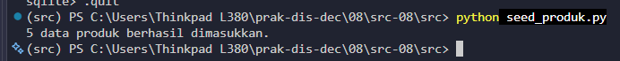

**Penjelasan:**

Perintah tersebut digunakan untuk menjalankan script Python yang telah dibuat. Program akan membuat tabel produk apabila belum tersedia, kemudian memasukkan lima data produk ke dalam database SQLite.

Apabila proses berhasil, terminal akan menampilkan pesan bahwa lima data produk berhasil dimasukkan.

### Langkah 10. Memeriksa hasil penyimpanan data

Jika SQLite CLI tersedia, jalankan:

```powershell
sqlite3 departemen-sdm.db
```

Kemudian tampilkan daftar tabel:

```sql
.tables
```

Tampilkan seluruh data produk:

```sql
SELECT * FROM produk;
```

Untuk memeriksa struktur tabel:

```sql
.schema produk
```

Keluar dari SQLite:

```sql
.quit
```

**Screenshot:**

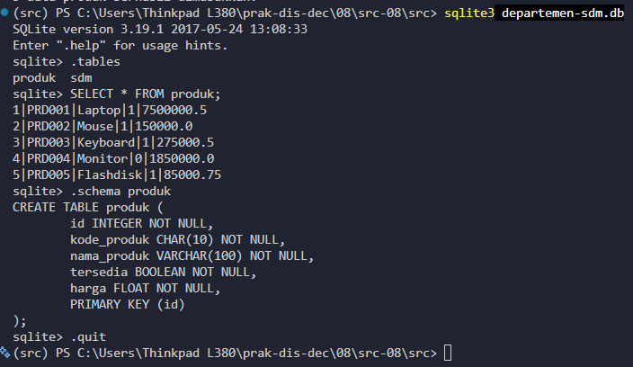

**Penjelasan:**

Pemeriksaan dilakukan untuk memastikan bahwa tabel produk telah berhasil dibuat dan berisi lima data yang sebelumnya dimasukkan melalui script Python.

Perintah `SELECT * FROM produk` digunakan untuk menampilkan seluruh data yang tersimpan pada tabel. Sementara itu, perintah `.schema produk` digunakan untuk melihat struktur tabel beserta tipe data yang digunakan.

## 4.6 Membuat RESTful API Menggunakan FastAPI

### Langkah 11. Menambahkan endpoint produk pada service.py

Buka kembali file `service.py`.

Pertahankan endpoint SDM yang sudah tersedia. Kemudian tambahkan kode berikut di bawah fungsi `read_sdm()`:

```python
@app.get("/produk/", response_model=List[Produk])
def read_produk(session: Session = Depends(get_session)):
    # SQLModel select statement
    statement = select(Produk)
    results = session.exec(statement).all()
    return results
```

**Screenshot:**

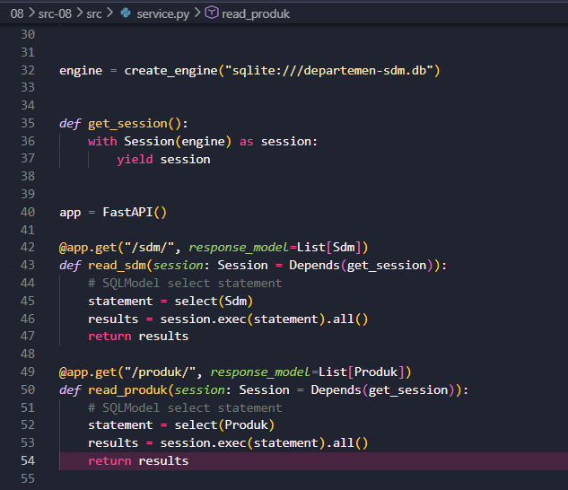

**Penjelasan:**

Pada tahap ini ditambahkan endpoint baru menggunakan metode HTTP GET dengan alamat `/produk/`. Endpoint tersebut digunakan untuk mengambil seluruh data produk yang tersimpan dalam database SQLite.

Perintah `select(Produk)` digunakan untuk membuat pernyataan pengambilan data. Selanjutnya, `session.exec(statement).all()` digunakan untuk mengambil seluruh data dari tabel produk.

Hasil pengambilan data kemudian dikembalikan oleh FastAPI dalam format JSON.

Dengan penambahan endpoint ini, aplikasi memiliki dua endpoint, yaitu `/sdm/` sebagai endpoint bawaan dan `/produk/` sebagai endpoint baru yang dibuat dalam tugas praktikum.

## 4.7 Menjalankan Aplikasi FastAPI

### Langkah 12. Menjalankan server aplikasi

Jalankan perintah berikut:

```powershell
uvicorn service:app --reload
```

**Screenshot:**

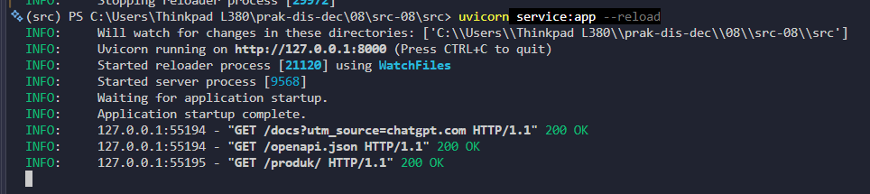

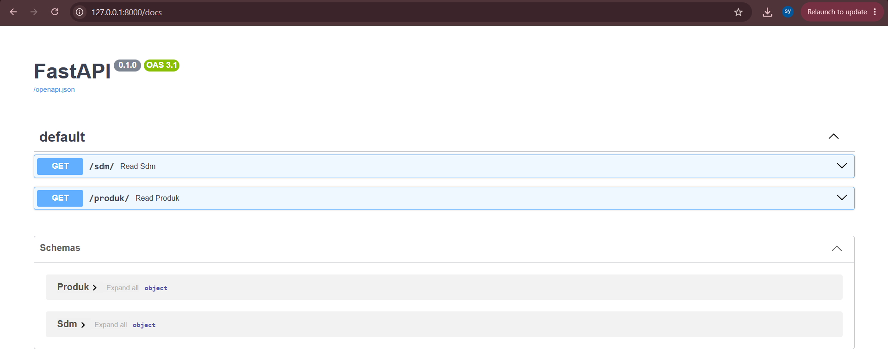

**Penjelasan:**

Perintah tersebut digunakan untuk menjalankan aplikasi FastAPI menggunakan server Uvicorn.

Bagian `service:app` menunjukkan bahwa aplikasi berada pada file `service.py` dengan objek FastAPI bernama `app`. Opsi `--reload` digunakan agar server melakukan pemuatan ulang secara otomatis ketika terjadi perubahan pada source code.

Apabila aplikasi berhasil dijalankan, server dapat diakses melalui alamat:

```text
http://127.0.0.1:8000
```

Terminal server harus tetap berjalan selama proses pengujian API.

## 4.8 Pengujian RESTful API

### Langkah 13. Mengakses endpoint melalui browser

Buka browser dan masukkan alamat berikut:

```text
http://127.0.0.1:8000/produk/
```

**Screenshot:**

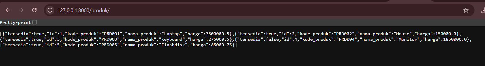

**Penjelasan:**

Pengujian melalui browser dilakukan untuk memastikan endpoint produk dapat diakses dan memberikan respons dari server.

Ketika alamat endpoint dibuka, FastAPI akan menjalankan fungsi `read_produk()` untuk mengambil seluruh data dari database SQLite. Data yang berhasil diperoleh kemudian ditampilkan dalam format JSON.

### Langkah 14. Memeriksa dokumentasi API

Buka alamat berikut melalui browser:

```text
http://127.0.0.1:8000/docs
```

**Screenshot:**

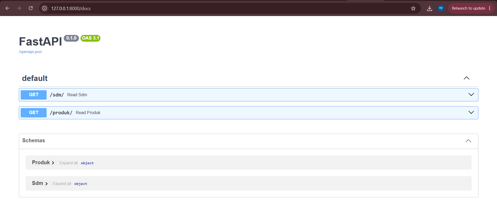

**Penjelasan:**

FastAPI menyediakan dokumentasi API secara otomatis menggunakan Swagger UI. Halaman ini menampilkan daftar endpoint yang tersedia beserta metode HTTP yang digunakan.

Pada praktikum ini, endpoint GET `/produk/` dapat dilihat dan dicoba secara langsung melalui halaman dokumentasi tersebut.

### Langkah 15. Menguji endpoint menggunakan curl

Buka terminal PowerShell kedua tanpa menghentikan server FastAPI, kemudian jalankan:

```powershell
curl.exe http://127.0.0.1:8000/produk/
```

**Screenshot:**

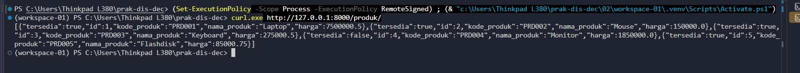

**Penjelasan:**

Perintah `curl.exe` digunakan untuk mengirimkan permintaan HTTP GET kepada endpoint `/produk/` pada server FastAPI.

Server akan memproses permintaan dengan mengambil seluruh data produk dari database SQLite. Hasil pengambilan data kemudian dikirimkan kembali kepada client dalam format JSON.

Pengujian ini merupakan tahap akhir dari tugas praktikum, yaitu menampilkan seluruh data yang telah dimasukkan menggunakan script Python melalui RESTful API dengan bantuan curl.

# 5. ANALISIS HASIL PRAKTIKUM

Pada praktikum Modul 8 dilakukan pengembangan terhadap source code yang telah disediakan dengan menambahkan tabel baru bernama produk pada database SQLite.

Tabel produk memiliki satu primary key dan empat kolom tambahan dengan tipe data CHAR, VARCHAR, BOOLEAN, dan FLOAT. Lima data produk dimasukkan menggunakan script Python melalui SQLModel.

Selanjutnya, endpoint GET `/produk/` ditambahkan ke dalam aplikasi FastAPI. Endpoint tersebut digunakan untuk mengambil seluruh data produk yang tersimpan di dalam database dan mengembalikannya dalam format JSON.

Pengujian dilakukan menggunakan curl untuk memastikan bahwa data yang telah dimasukkan dapat diakses melalui RESTful API.

Dengan adanya penambahan tersebut, aplikasi yang sebelumnya hanya menyediakan layanan untuk menampilkan data SDM kini juga dapat menyediakan layanan untuk menampilkan data produk.

# 6. KESIMPULAN

Berdasarkan praktikum Modul 8 tentang Arsitektur Microservices untuk Sistem Terdistribusi, dapat disimpulkan bahwa source code FastAPI yang telah disediakan dapat dikembangkan dengan menambahkan tabel dan endpoint baru tanpa harus membuat aplikasi dari awal.

Pada praktikum ini dibuat tabel produk dengan tipe data INT, CHAR, VARCHAR, BOOLEAN, dan FLOAT. Lima data produk dimasukkan ke dalam database menggunakan script Python dengan bantuan SQLModel.

Selanjutnya, RESTful API dibuat menggunakan FastAPI untuk menampilkan seluruh data produk melalui endpoint GET `/produk/`. Pengujian dilakukan menggunakan curl untuk melihat respons yang diberikan oleh server dalam format JSON.

Melalui praktikum ini, diperoleh pemahaman mengenai penggunaan FastAPI, SQLModel, SQLite, serta penerapan RESTful API sebagai salah satu bentuk implementasi sistem terdistribusi.

---

# REFERENSI

1. Modul 8 Praktikum Sistem Terdistribusi dan Terdesentralisasi, Universitas Teknologi Digital Indonesia.
2. Dokumentasi FastAPI: https://fastapi.tiangolo.com/
3. Dokumentasi SQLModel: https://sqlmodel.tiangolo.com/
4. Dokumentasi SQLite: https://sqlite.org/docs.html
5. Dokumentasi uv: https://docs.astral.sh/uv/